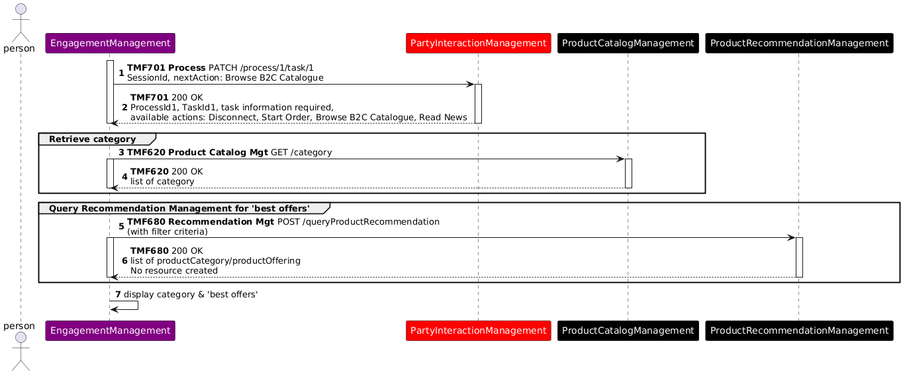
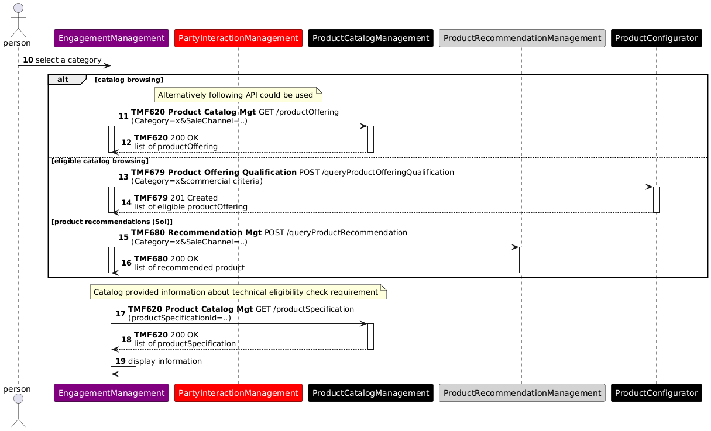
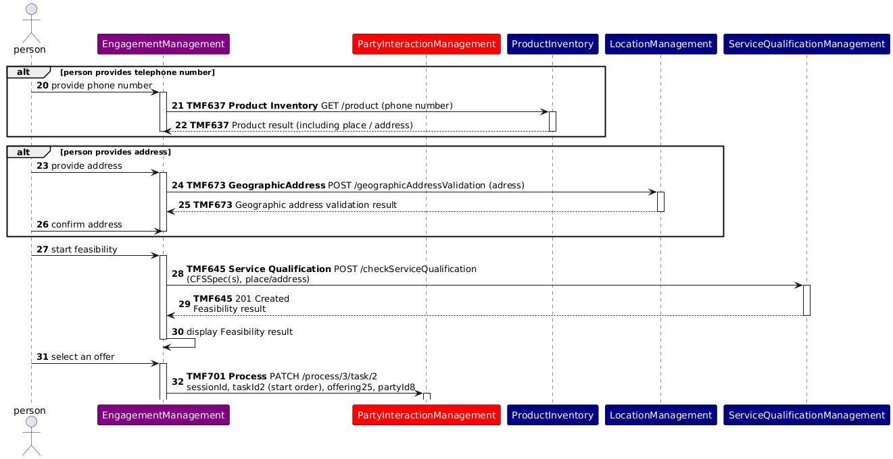
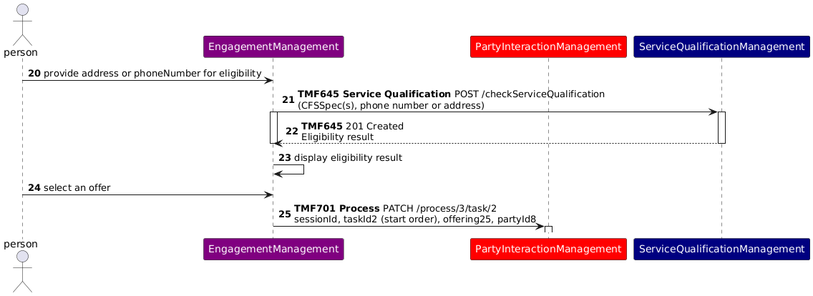

# Executive Summary

The use case demonstrates how catalogue browsing, product recommendations, commercial qualification and technical service qualification can be combined while maintaining separation between engagement, commerce and production capabilities.

# Introduction

## Context or Background

This use case illustrates a set of ODA components and TMF Open APIs that can provide Product Catalog information and Product Offering recommendations, based on marketing rules and/or customer context analysis.

This use case follows TMFS001.

## Objective of the use case

The target audience is architects and practitioners designing B2C digital commerce journeys using ODA Components and TM Forum Open APIs. The business objective is to help a customer identify commercially relevant internet offers and determine whether fibre service is technically available before starting order capture.

This is demonstrated in the use case by showing how a front-end user can search and get Product Catalog information, and how to present relevant marketing recommendations.

This use case also demonstrates that a front-end can directly use TMF Open APIs to query information - and build and fill its GUI with the results.

## Scope and assumptions

### Scope

In this use case, John Smith, the front-end user, is interested in Internet offers, and more specifically by Fiber offers. He browses the B2C catalog, and a technical eligibility test is proposed, to check if Fiber is available for him or not.

### Assumptions

In this use case we consider that the CSP decided to use the Fiber technology as a sales argument - so he makes it explicit in the contract names, and for the technical eligibility test. This is possible and common because B2C customers are well aware that Fiber technology exists, permits higher speeds and is not available in every location because a new Fiber network takes time to be deployed. B2C customers also know that Fiber contracts are more expensive.

Another possibility would be to name contracts as "High speed Internet offers", and at technical eligibility level to only share with B2C customers a range of speeds available in a specific location. So, Fiber and ADSL technologies are only explicit at technical solution level (RFS specification).

These 2 options are possible and consistent with ODA architecture and decoupling principles, and with the Catalog information model. CSP business owners can choose. 

# Description

This describes the end-to-end user journey for browsing the B2C catalogue and checking technical eligibility for fiber offers. The flow is presented as a sequence of steps, supported by user interface views, to illustrate how catalogue browsing, recommendations, and eligibility validation are combined.

- Step 1

- John Smith is identified / authenticated on the CSP website (or mobile app) and the list of available actions is displayed (following TMFS001)

- He chooses to browse the operator catalogue.

- The list of available actions is refreshed (same list)

- The Front-End builds the B2C Catalogue start screen, by directly querying the Product Catalog component to retrieve the lines of products (managed as categories), and the Product Recommendation Management component to retrieve the product offerings to push1.

- Step 2

- The front-end presents the lines of products, as well as the operator current best offers

- John Smith chooses the Internet Line of Product

- The Front-End identifies the product offerings corresponding to this line of products

- Step 3

- The Front-End analyses the description of the Fiber Product specification included in the 3 possible offers and identifies that a technical eligibility test is mandatory.

- The front-end displays the selection of internet offers, and proposes to check fiber technical eligibility based on the person's fixed phone number or geographical address

- John Smith enters his fixed phone number and triggers the test

- Step 4

- Eligibility check is OK.

- John Smith can now start an order capture process, choosing one of the proposed fiber offers

1 We consider here that the Product Recommendation Management component is able to check the product offering qualification before pushing them.

*([text description](media/catalogue-browsing-eligibility-ui-mockup.text-description.md))*

**Figure 1. GUI Illustration**

# Views

## Information View

This view presents 3 examples of contract level Product Offerings commercializing a Fiber Access product. It illustrates that:

- The same product specification can be commercialized through several product offerings, and even more that a product offering can restrict the characteristics values of the product specification.

- The same product offering can be packaged in several composite product offerings

- Product offering pricing rules (POP) can evaluate product specification characteristics values

- Product offerings can be associated to market segments and sales channels - and classified in line of products (as categories - not described in the view)

- The Fiber Access product specification is based on a CFS specification - this link will be used for the technical eligibility test, that is configured as mandatory for this product specification as the Fiber Network is not available in all locations.

*([PlantUML source](media/product-catalog-view-fiber-offers.puml))*

**Figure 2. Product Catalog View**

# Diagrams

## Sequence Diagrams

The following sequence diagrams illustrate how the high-level steps described above are realized through interactions between ODA components and TMF Open APIs. Each diagram corresponds to a step in the flow and details the sequence of API calls and component responsibilities required to execute that functionality.

###  Step 1 - Build the B2C Catalogue start screen

** **

*([PlantUML source](media/catalogue-start-screen-sequence.puml))*

**Figure 3. Sequence Diagram - Step 1 Build B2C Catalog**

| API Version Alignment Note This interaction was modeled using v4 of TMF620 and the name ProductCategory and has now been re-aligned to v5 Category. It also used v4 TMF701 Process Flow that with v5 has been renamed to Process Management. The interaction shown in this use case represents the business intent of maintaining interaction context during the pre-qualification journey rather than prescribing a specific v5 resource implementation. |
| --- |

### Step 2 - Build the Internet Line of Product screen

The front-end can use 3 ways of identifiying the product offerings of this Line of Product to display:

- a simple query of the Product Catalog, to display all the possible product offerings

- a query based on the Product Configurator, to only display the product offerings commercially available for John Smith

- a query based on the Product Recommendation engine, to display the product offerings recommended for John Smith, according to marketing criteria and John Smith individual information.

When the list of product offerings is available, the front-end also query the Product Catalog at Product Specification level to identify if a technical eligibility test is needed, according to catalog parameters.

*([PlantUML source](media/line-of-product-screen-sequence.puml))*

**Figure 4. Sequence Diagram - Step 2 Build Internet Line**

| API Version Alignment Note This interaction was originally modeled using TMF679 v4 ProductOfferingQualification and has now been re-aligned to v5 QueryProductOfferingQualification. |
| --- |

### Step 3 - Test Fiber Product Technical Eligibility

As in the Product Catalog the Fiber Access product specification is defined with a mandatory eligibility test, this test is directly proposed to John Smith who provides an address and launches the test. In this illustration, we have shown how the address can be both inserted or in the case that John already had a service such as a landline, the address can be retrieved from his phone number. Other possibilities are possible, such as retreiving the address also through John's account. Below is an illustration of two of those possibilites and not exhaustive. 

The test is configured with the CFS specification identifier associated to the Fiber Access Product specification.

As the test is OK, the list of proposed Fiber contracts remains the same, and John Smith can choose one of them to start an order capture process (continued in TMFS003).

*([PlantUML source](media/fiber-eligibility-test-address-retrieval-sequence.puml))*

OLD Sequence Diagram maintained for discussion. The new above has been modified to only have address as input and shows how the address is retreived bevore calling Service Qualification. Based on feedback from Bostjan below in the comments section

*([PlantUML source](media/fiber-eligibility-test-previous-sequence.puml))*

**Figure 5. Sequence Diagram - Step 3 Test Fiber Product Technical Eligibility**

# Conclusion

## Lessons learned

ODA Functional Architecture introduces a strong decoupling principle between Engagement Management and all the other ODA Functional Blocks in charge of business processes. So, front-ends cannot directly create or update information, only a business process layer can.

But this use case illustrates that front-ends can directly query information to build and fill their different screens, here Product Catalog and Product Recommendation information.

The use case also distinguishes commercial offering discovery from technical service qualification: commercially relevant offerings are identified first, after which service qualification determines whether the underlying fibre service is available at the customer’s location.

## Impacts identified

Document impacts identified during the analysis of the use case. Impacts may relate to APIs, ODA Components, Information Models, Use Cases, External Standards, or other relevant assets. Where follow-up work exists or has been identified include references to the relevant work items in JIRA.

| Asset Type | Asset | Impact Description | Related Work Item(s) |
| --- | --- | --- | --- |
| ODA Component | IG1242/TMFC050 | In the ODA Directory online the functional block for TMFC050 is COre Commerce but the published IG1242 it is listed as Intelligence Management. | TAC-1415 - Inconsistency between IG1242 and the ODA Directory - TMFC050  backlog   *([text description](media/status-dot-icon.text-description.md))* |

**Table 5. Impacts Identified**

