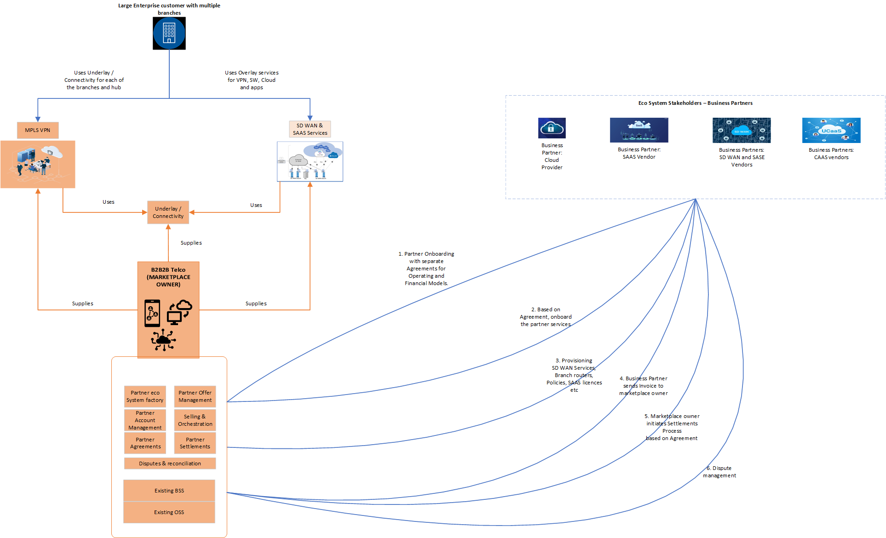
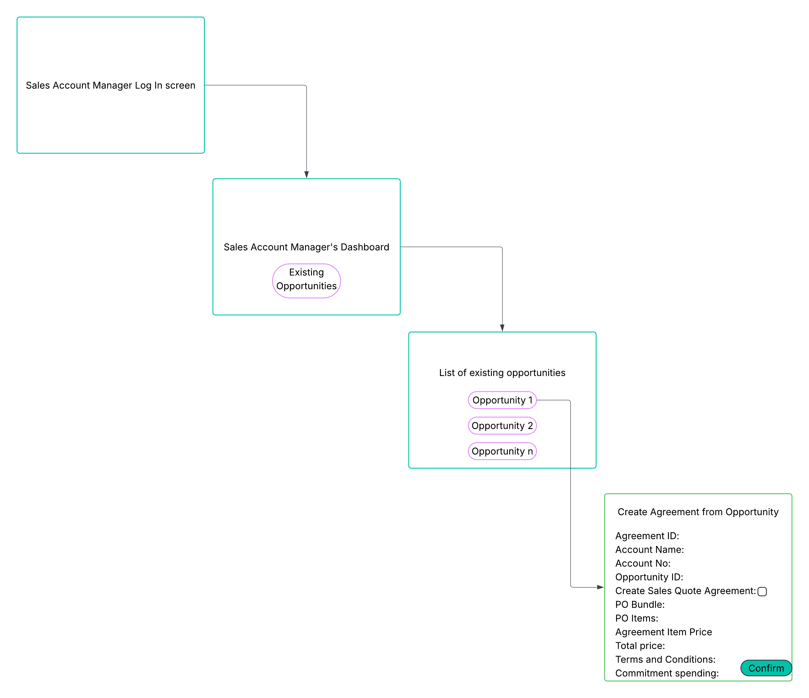
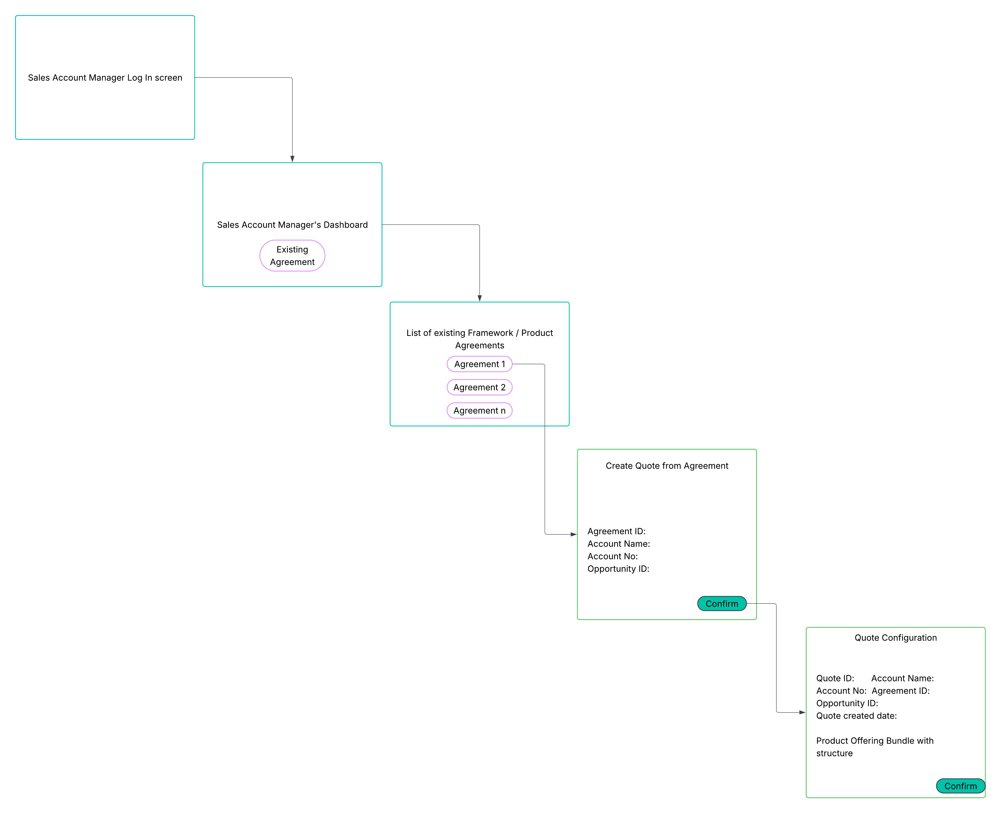
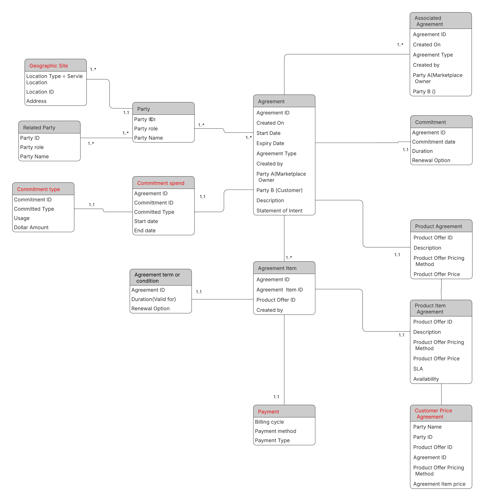
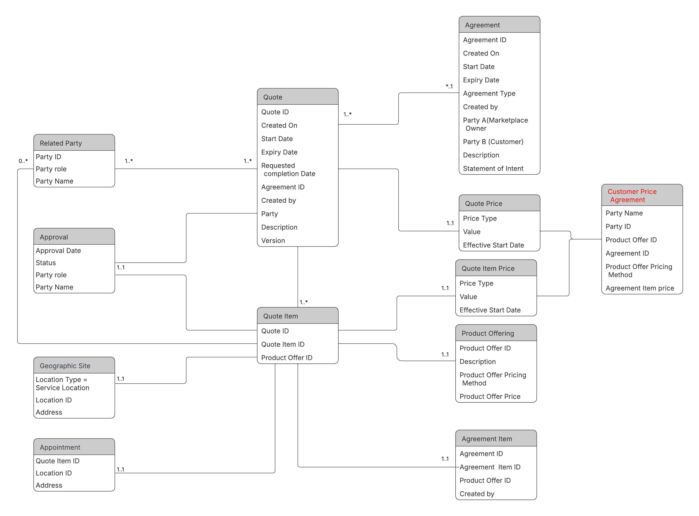
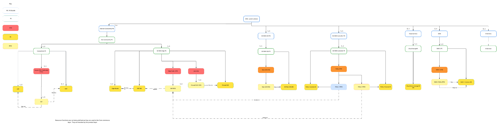
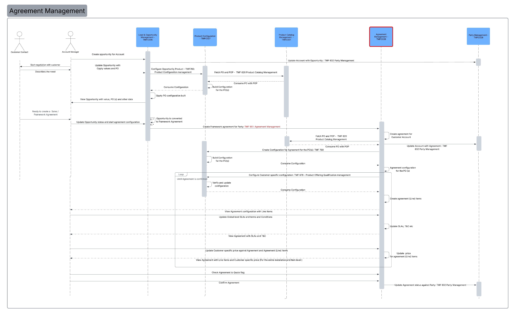
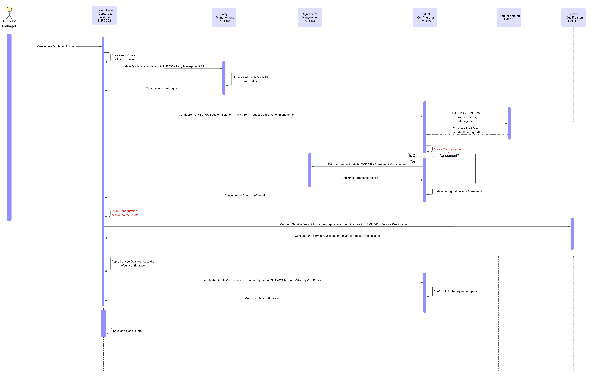
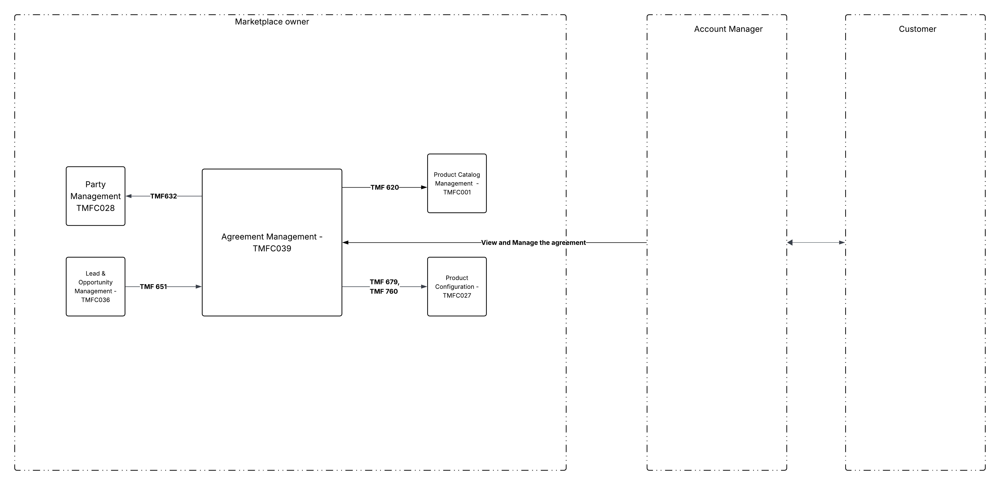

# Executive Summary

The use case outlines how a B2B2x marketplace owner (a Telco) manages complex, multiparty commercial engagements with large enterprises purchasing custom SD‑WAN/SASE solutions. These solutions combine connectivity owned by the Telco with “beyond connectivity” services from multiple partners such as hyperscalers, SaaS vendors, and ICT providers. Because these deals span many sites, domains, and vendors, the sales cycle requires structured Agreement, Quote, and Service Contract management rather than ad hoc negotiation. As stated in the document, *“The Framework Agreement with the commercial terms and conditions plus the features of the solutions should have been defined and agreed… before I start the process of the actual Quote and Order capture.”*

Child Use Case A—Framework Agreement Management—is the focus of this sprint. It defines how the Account Manager creates and negotiates a global agreement that captures commercial terms, legal clauses, customer‑specific pricing, and high‑level technical configurations for all sites. This agreement becomes the foundation for subsequent Quote and Service Contract creation, ensuring consistency, catalog‑driven configuration, and reduced downstream complexity. As the document notes, *“This process also makes the later steps of Quote configuration and Order Management a lot smoother.”*

Child Use Case B and C - Will be updated after they are completed in the Oct - Dec Sprint. 

# Introduction

The Use case explains the activities of Agreement management, Quote and Contract management between marketplace owner and large enterprise customers where the entire sales and over process is for a custom solution that is made up of components from different vendors which are tied to the connectivity offered by the marketplace owner. 

Sometimes the contract is a tripartite agreement between the end customer, the marketplace owner and the partner (vendor) and in some cases it is a bipartite agreement between the marketplace owner (B2B2X Telco) and the end customer. In both cases the marketplace owner needs to have separate agreements with the vendor and that is given in a separate use case.

*This and the other Use Cases around B2B2x assume that the person reading this has gone through the other documentation done earlier which provides the context to the topic of marketplaces. **A few of** them **are listed** here*

[https://www.tmforum.org/resources/exploratory-report/tr302-oda-ecosystem-challenges-and-roadmap-proposal-v2-0-1/](https://www.tmforum.org/resources/exploratory-report/tr302-oda-ecosystem-challenges-and-roadmap-proposal-v2-0-1/)

[https://www.tmforum.org/resources/introductory-guide/ig1317-oda-dse-platform-extensions-patterns-for-b2b-b2b2x-partner-ecosystems-v3-0-0/](https://www.tmforum.org/resources/introductory-guide/ig1317-oda-dse-platform-extensions-patterns-for-b2b-b2b2x-partner-ecosystems-v3-0-0/)

[https://www.tmforum.org/resources/reference/ig1282-oda-design-challenges-in-applying-b2c-solutions-to-b2b-b2b2x-requirements-v1-0-0/](https://www.tmforum.org/resources/reference/ig1282-oda-design-challenges-in-applying-b2c-solutions-to-b2b-b2b2x-requirements-v1-0-0/)* *

[https://www.tmforum.org/resources/introductory-guide/ig1262-software-marketplaces-a-new-go-to-market-opportunity-for-communications-service-providers-v1-2-0/](https://www.tmforum.org/resources/introductory-guide/ig1262-software-marketplaces-a-new-go-to-market-opportunity-for-communications-service-providers-v1-2-0/)

[IG1279 Zero-Touch Partnering Vision & Strategy v3.1.0](https://projects.tmforum.org/wiki/pages/viewpage.action?pageId=309825995)

[https://www.tmforum.org/resources/introductory-guide/tr303a-federated-identity-and-authentication-management-for-multi-domain-zero-trust-architecture-v4-0-0/](https://www.tmforum.org/resources/introductory-guide/tr303a-federated-identity-and-authentication-management-for-multi-domain-zero-trust-architecture-v4-0-0/)

[GB1027C Zero-Touch Partnering Use-Cases v6.0.0](https://projects.tmforum.org/wiki/display/PUB/GB1027C+Zero-Touch+Partnering+Use-Cases+v6.0.0)

## Context or Background

*([text description](media/b2b2x-marketplace-ecosystem-context-diagram.text-description.md))*

**Fig 1-1 Digital Eco-System of a B2B2x marketplace**

In the diagram above there are 3 stakeholders in the marketplace. 

- The Marketplace owner i.e. Telco

**Marketplace owner (B2B2xTelco)** who owns the connectivity i.e. Active assets at Customer site, Customer edge ,the Provider Edge Routers and the backbone. It maybe a case where one of the sites is Off Net and a different CSP as a partner may come in. However, because that scenario is being covered in the wholesale Broadband scenarios, in this Use Cases it is assumed that the Telco has Connectivity across sites and the partners will provide the Beyond Connectivity offering

- Business partners like Hyperscalers, SW vendors

**Business Partners (Cloud Services Vendor, SDx vendor SAAS Vendor, CAAS vendors, ICT vendors etc.)** are the providers of the beyond connectivity services like SD-WAN services, Cloud Compute, SW services and even Computing HW

- Customer who is a large enterprise or a government agency

 **Customer (A large enterprise)** who purchases the solution of connectivity and beyond connectivity services which are spanning across multiple partners, multiple domains and installed across multiple sites i.e. The Enterprise has many offices which require the connectivity and beyond Connectivity services. The connectivity can be MPLS-VPN or Business Internet shared connection as the case may be. Layer 2 VPN is configured across all the sites. Some sites have dedicated SAAS SW and some do not. Hence, the configuration needs to happen per site, so Service Feasibility check per site is very important

The value stream of Opportunity 2 Order in the Digital Eco System shown above will be described in the subsequent sections of the Use Case.

*The scenario for this UseCase:*

 A SD-WAN solution is being negotiated for a 100 site implementation. There will be a global level Framework Agreement for that entire SD-WAN solution across the 100 sites. For each site or a set of sites, there will be quotes specific to that site based on Service Qualification but under the umbrella of the terms and conditions spelled out in the agreement. For each quote, there will be a Service Contract detailing the technical configuration like the entitlements and SLAs for each installation

## Objective of the use case

Due to the complexity, we are splitting this UseCase TMFS020 into 3 Child Use Cases

### Child Use Case A 

As an Account Manager / Account Executive 

I want to.... create a Sales or a Framework agreement with my large enterprise customer 

So that... All the commercial terms and conditions, legal clauses and global level technical configurations common to all parts of the customer (large enterprise with many offices) will be defined and agreed in this agreement before I start the process of the actual Quote and Order capture

*Entry Criterion:*

Partnership agreement with the business partners to supply and provide the components and services required for the custom solution that is sold are completed (Defined in TMFS019)

The components and services (with the SLAs and entitlements) belonging to the partners are onboarded into the Marketplace catalog (Currently not defined in any UseCase)

The Party (Customer Account) who is purchasing the SD-WAN / SASE solution from the marketplace owner (<Managed services provider) is available along with the related parties (contacts)

*Exit Criterion:*

The Framework Agreement with the commercial terms and conditions plus the features of the solutions should have been defined and agreed between the marketplace owner and the large enterprise customer. 

Customer specific pricing and customer specific service limits if any are defined and confirmed by both the parties

The agreement is formally accepted as the frameworks for all future Quotes and Contracts between both the parties

### Child Use Case B

As a Sales manager

I want to.... create a Commercial quote for the customer by referring to the Agreement

So that... All the commercial and legal terms and conditions defined in the Framework Agreement are followed and the Quote configuration happens using the Framework Agreement / Product Agreement as the reference. 

*Entry Criterion:*

The customer account with the Agreement is existing and the Agreement (Framework / Product Agreement ) against the account is in confirmed state. 

The Framework Agreement  / Product Agreement (Terminology to be decided) is completed, confirmed by both the parties and can be referred for the Quote configuration. 

The required details of the Framework / Product Agreement (Exact terminology?) including the Customer negotiated pricing, configuration done (using the product Configuration) are available for the Quote configuration and Quote calculation

*Exit Criterion:*

The commercial Quote should have been confirmed by the customer.

### Child Use Case C

As a Solution Architect

I want to.... create a Service Contract / Implementation agreement / Implementation contract (Exact terminoogy??) for the customer based on the quote that was approved / confirmed by the customer

So that... The technical SLA and entitlements that the customer is entitled to are configured before they are submitted for fulfillment

*Entry Criterion:*

The Commercial quote is confirmed  

The relationships of the SLAs and entitlements of the contract should be defined against the Product offerings that were configured in the quote stage

*Exit Criterion:*

The compatibility of the SLA s configured, and new entitlements added is checked against the product Offerings and the associated product Specifications of the Quote line Items

## Scope and assumptions

### Scope

The Use Case has 3 parts and Child Use Case A is in scope for this sprint. 

*In Scope: *

The scope of this Use case encompasses 3 activities in the Selling and Order Capture processes when a B2B2x custom solution is sold to a large enterprise or a government agency 

-  **Child Use Case A: **Negotiating an agreement ( type = Framework Agreement) with the large enterprise / Government agency. The Framework Agreement Management process is a cross-functional workflow that 

- Governs the creation, validation, approval, and confirmation of Framework Agreements.

- Ensures all agreements are properly documented, comply with internal policies and partner requirements, and are aligned with account-specific commitments, Account specific pricing and SLAs before being sent to the customer for signature.

- **Child Use Case B: **Creating** **one or more quotes against the Framework / Product Agreement and using the agreement terms and conditions as reference 

- Governs the configuration, service qualification checks for each site, approval, and confirmation of the quote(s).  

- Ensures the Quote configuration with the product offering and the associated Product Specification are in line with the configuration specified during the Framework agreement. 

- One Agreement can have multiple quotes, and all the quotes will be created based on the Agreement terms and conditions

*Out of Scope:*

- Onboarding Partner product offerings to the Product catalog.

- Setting up the Product catalog and defining new architectural patterns to store the customer negotiated product price.

- Relationship of the partner Agreement with the Product Offerings.

- Setting up the Customer Account with the hierarchy including the billing profile.

### Assumptions

**Pre-Requisites for this use Case:**

- Provided in the Entry and Exit criterion above

# Description

## GUI Flow for Child Use Case A The flow is indicative with sample fields not meant to be taken as a design guideline. 

It describes the flow when the Sales Account Manager for a Large Corporate interested in the SDx solution shown in the Information model section 3.1.4 is creating an Agreement of type <Framework Agreement> between the Marketplace owner (Telco) and the large enterprise. It is assumed that an opportunity already exists with the Account details. 

*([text description](media/framework-agreement-from-opportunity-gui-flow.text-description.md))*

## GUI Flow for Child Use Case B

*([text description](media/quote-from-agreement-gui-flow.text-description.md))*

The actual configuration steps are not shown in the diagram because the shopping cart is not specific to B2B2x. The configuration is driven by the Product Offerings from the catalog with the  terms & conditions and pricing carried over from the framework / product agreement. 

# Views

## Information View

### Agreement Logical model

This is a draft because this is currently WIP with the API teams. The Agreement is being detailed as Product Agreement / Framework Agreement (Terminology with definitions?).  Once the latest version of the TMF 651 API resource models is published, this diagram will be updated in the next version. The customer specific price in the Agreement here is present in the TMF651 specification but not detailed as a resource. This can be considered as a requirement to the Open API team. 
The other consideration for the Customer Price Agreement when large enterprise deals involving B2B / B2B2x services scenarios is - there are very low volume of customers who purchase these B2B/B2B2x customer / bespoke solutions. Hence, the pricing is different for each customer even though the same POs with different configurations are stitched together to create the custom / bespoke solution. 

In normal B2C and SMB scenarios, the pricing should be driven off the definition in the catalog and there may not be the need for an Agreement. 

*([PlantUML source](media/agreement-logical-model.puml))*

### Quote Logical Model

The Quote information model isi given below. This largely refernces the TMF 648 resourece model and a coupolke of enhancements are being proposed in thise model considering the B2B2x sceanrios

- Quote Item and Quote relationship to Customer price agreement (If this has been considered considered in the latest version of TMF 648 resource model, then this enhancment is not needed) 

- Geographic site to Quote Item as Service location in multi Site VPNs is aginst the line item and not the header

- Approval is being modelled on the Quote item also as multi site VPNs or connectivity deals for Commercial Aerospace etc.,  will have approvals at Item level.

*([PlantUML source](media/quote-information-model.puml))*

### Service Contract Logical Model

### Product Offering Logical Model

The logical model of the Product Offer bundle (SASE Custom solution bundle) is given below. The name of the PO bundle is SASE Custom solution bundle i.e A Customer orders a set of underlay connectivity with dedicated access and / or shared internet for X number of sites and has SDx services at every site with network and security policies managing the WAN. Additional services like Cloud, SaaS, SI services are also in the bundle as optional PO s.
This is to emphasize that the Catalog is driving the process and the Opportunity configuration and Agreement configuration should be based on the catalog definition instead of free text or document / spreadsheet uploads. 
In Use Case A, only the Product Offerings will be driving the configuration.

In Use Cases B & C (not in scope for sprint ending on Oct 1st), the Product Offerings and Product Specifications will be driving the configuration. 

*([PlantUML source](media/sase-custom-solution-product-offering-model.puml))*

## Value Network / Streams View

# Diagrams

## Sequence Diagrams 

The Sequence diagrams for the 3 child Use Cases are given below. 

**Note: **Channel management i..e Engagement layer is not in the scope of these usecases. The aim of the is to show the flow from Opportunity to Agreement (Framework Agreement / Product Agreement) to Quote to Contract(Service Contract / Implemenation contract) and the dependency of the ODA components with the TMF APis and identify any enhancements needed. Same way, the Party interaction ODA component is not being considered because the focus of these use cases is in the B2B2x aspects rather than repeating the common patterns for the B2C usecases whcih have already been defined in the other use cases.

### Sequence diagram for Agreements

*([PlantUML source](media/agreement-management-sequence.puml))*

Description:

The Sequence flow is described below

| Operation | Operation Type  = API | ODA Components involved | Open APIs involved | Description |
| --- | --- | --- | --- | --- |
| Create opportunity for Account - | No | Lead & Opportunity Management - TMFC036 (Server) | NA | The Account manager creates an opportunity against the Customer Account of the Large enterprise interested in the B2B2x managed services custom solution PO bundle with underlay & overlay services |
| Update Account with Opportunity -: TMF 632 Party Management | Yes | Party Management - TMFC028 (Server) Lead & Opportunity Management - TMFC036 (Client) | TMF 632: Party Management | The Opportunity created is updated against the Party (Customer described above). These relationships are important because currently the ODA components do not have the dependency or relationships among them. They will be detailed in Section 4.2 |
| Start negotiation with customer | No | NA | NA | The Account manager starts negotiation with the customer in an effort to convert the Opportunity into Framework Agreement. It is not mandatory to always have a Framework Agreement, and the Opportunity can be converted to a quote. It is suggested that the Framework Agreement be used for large complex deals involving a multitude of services and installed across many sites. |
| Describes the need | No | NA | NA | This is the needs analysis phase. There is no ODA component that maps to this functionality. The one that remotely comes close is Sales Management. But for the purpose of this use case this is kept as an offline interaction since the focus of this Use Case is Framework Agreement Management |
| Update Opportunity with Opportunity values and PO | No | Lead & Opportunity Management - TMFC036 (Server) | NA | Based on the understanding of the customer need, the Account manager updates the opportunity |
| Configure Opportunity Product - TMF760: Product Configuration management | Yes | Product Configuration - TMFC027 (Server) Lead & Opportunity Management - TMFC036 (Client) | TMF760: Product Configuration management | The PO bundle is configured at a very high level against the Opportunity. This will require a relationship of the ODA Component Product Configurator with Sales Management. Currently, Product Configurator only has a relationship with Product Order capture and validation. Note: The configuration done here is optional and if done is very high level with the POs only with minimal configuration and is intended to replace the notes that are usually written against an opportunity. In B2B2x services free text notes leads to errors due to the complexity. |
| Fetch PO and POP - TMF 620 Product Catalog Management | Yes | Product Catalog Management - TMFC001 (Server) Product Configuration - TMFC027 (Client) | TMF 620 Product Catalog Management | The product configurator that has been invoked by the Opportunity fetches the PO(s) and the corresponding default POP |
| Consume PO with POP | Yes: Response | Product Catalog Management - TMFC001 (Server) Product Configuration - TMFC027 (Client) | TMF 620 Product Catalog Management | Product Configurator has the PO(s) and the corresponding POP ready for configuration |
| Build Configuration for the PO(s) | No | Product Configuration - TMFC027 | NA | The configuration is now done by the product Configuration component |
| Consume Configuration | Yes: Response | Product Configuration - TMFC027 (Server) Lead & Opportunity Management - TMFC036 (Client) | TMF760: Product Configuration management | The configuration is consumed by the opportunity to generate the opportunity product with the high level configuration |
| Oppty PO configuration built | No | Lead & Opportunity Management - TMFC036 | NA | Same as aboove |
| View Opportunity with value, PO (s) and other data | No | NA | NA | Account Manager views the configuration against the Opportunity |
| Ready to create a Sales / Framework Agreement | No | NA | NA | Custoemr has reached the stage in negotiation to start the Agreement process |
| Update Opportunity status and start agreement configuration | No | Lead & Opportunity Management - TMFC036 | NA | Account manager updates the opportunity as converted to Agreement  / Agreement being created and starts the Agreement process |
| Opportunity is converted to Framework Agreement | No | Lead & Opportunity Management - TMFC036 | NA | Opportunity is converted to Agreement / Opportunity is updated as ready for Agreement stage (Next stage in the Opportunity lifecycle if defiend) |
| Create Framework Agreement for Party: TMF 651: Agreement Management | Yes | Agreement Management - TMFC039 (Server) Lead & Opportunity Management - TMFC036 (Client) | TMF 651: Agreement Management | The agreement of type =FrameworkAgreement is created. Note: The agreement API currently is classified as a Business partner API and in this case, the Agreement needs to be created between the end customer and the marketplace owner and hence the necessary changes in the API map need to be made. |
| Create agreement for Customer Account | No | Agreement Management - TMFC039 | NA | The Framework Agreement for the customer is created with a unique Agreement ID etc. |
| Update Account with Agreement : TMF 632 Party Management | Yes | Party Management - TMFC028 (Server) Agreement Management - TMFC039 (Client) | TMF 632 Party Management | The Customer Account (party) is updated with the Agreement ID and status of the Agreement and other basic details. Note: Currently ODA does not have these relationships are dependencies except s resource models in the API s or SID Models. But ODA component to component relationship does not exist and these relationships and dependencies should be defined. |
| OPTIONAL: Fetch PO and POP - TMF 620 Product Catalog Management | Yes | Product Catalog Management - TMFC001 (Server) Product Configuration - TMFC027 (Client) | TMF 620 Product Catalog Management | OPTIONAL: The product configurator that has been invoked by the Agreement fetches the PO(s) and the corresponding default POP |
| OPTIONAL: Consume PO with POP | Yes: Response | Product Catalog Management - TMFC001 (Server) Product Configuration - TMFC027 (Client) | TMF 620 Product Catalog Management | OPTIONAL: Product Configurator has the PO(s) and the corresponding POP ready for configuration |
| Create Configuration for Agreement for the PO(s): TMF 760 | Yes | Product Configuration - TMFC027 (Server) Lead & Opportunity Management - TMFC036 (Client) | TMF760: Product Configuration management | The PO bundle with the child POs is configured at a very high level against the Agreement. This will require a relationship of the ODA Component Product Configurator with Agreement Management. Currently, Product Configurator only has a relationship with Product Order capture and validation. Note: This is a global level configuration and is not a site specific configuration. This is done during the negotiation for the entire Installation and sets the terms and conditions for the installation across all the sites. Hence, the Agreement is usually at the legal  / parent Account |
| Build Configuration for the PO(s) | No | Product Configuration - TMFC027 | NA | The configuration is now done by the product Configuration component |
| Consume Configuration | Yes: Response | Product Configuration - TMFC027 (Server) Agreement Management - TMFC039 (Client) | TMF760: Product Configuration management | The configuration is consumed by the Agreement |
| Agreement configuration for the PO (s) | No | Agreement Management - TMFC039 | NA | Generate  the Agreement items (Line Items) with the high level configuration |
| Configure Customer specific configuration: TMF 679 - Product Offering Qualification management | Yes | Product Configuration - TMFC027 (Server) Agreement Management - TMFC039 (Client) | TMF 679 - Product Offering Qualification management | The Customer specific pricing, PO attributes, terms and conditions (catalog driven) are configured. This is a global level configuration and not a site specific configuration. |
| Verify and update configuration | No | Product Configuration - TMFC027 (Server) | NA | The eligibility, compatibility checks is made, and the configuration is completed. |
| Consume Configuration | Yes: Response | Product Configuration - TMFC027 (Server) Agreement Management - TMFC039 (Client) | TMF760: Product Configuration management | The configuration is consumed by the Agreement |
| Create agreement (Line) Items | No | Agreement Management - TMFC039 | NA | The Agreement's configuration is deeper than Opportunity because this is driven actively by the customer. Hence, it is suggested the line item (Agreement items)need to be specified without the detailed configuration based on Service Qualification. For example, the Agreement at the global level says, all Employee Mobiles (Items in the Agreement and later Quote and Product Order) should only get 4G data. Or All sites in the SD-WAN installation should be limited to 1G with branch offices limited to 500M. This process also makes the later steps of Quote configuration and Order Management a lot smoother. |
| View Agreement configuration with (Line) Items | No | NA | NA | Account Manager views the configuration against the Agreement |
| Update Global level SLAs and terms and Conditions | No | Agreement Management - TMFC039 | NA | The Account manager configure the Global values against the Agreement Items (Line Items) |
| Update SLAs, T&C etc | No | Agreement Management - TMFC039 | NA | The terms and conditions and SLAs are updated. Not as free text to the best extent possible as attributes against the Agreement items. |
| View Agreement with SLAs and T&C | No | NA | NA | Account Manager views the configuration against the Agreement |
| Update Customer specific price against Agreement and Agreement (Line) Items | No | Agreement Management - TMFC039 | NA | The customer negotiated price is captured in the Agreement as Customer Price agreement, by the Account Manager. |
| Update price for agreement (Line) items | No | Agreement Management - TMFC039 | NA | The agreement is updated with the Customer price agreement. (The resource model is WIP for the TMF 651 team ) |
| View Agreement with Line Items and Customer specific price (For the entire installation and Item level ) | No | NA | NA | The Account manager views the Agreement with the high level configuration (commercial at the global level across the SD-WAN installation instead of site specific configuration) |
| Check Agreement to Quote flag | No | Agreement Management - TMFC039 | NA | Mark that Agreement T&C, pricing will override Quote when Quote is created from Agreement i.e. This results in a Sales Quote Agreement |
| Confirm Agreement | No | Agreement Management - TMFC039 | NA | Account manager confirms the Agreement |
| Update Agreement status against Party: TMF 632 Party Management | Yes | Party Management -TMFC028 (Server) Agreement Management - TMFC039 (Client) | TMF 632 Party Management | The confirmed agreement is now updated (Agreement status is updated) against the Customer Account |

### Sequence diagrams for Quotes

Important note: Should the Agreement to Quote relationship be 1:1 or 1:n? The assumption is it should be 1:n because a single Agreement (Framework / Product Agreement?) may result in multiple Quotes

*([PlantUML source](media/quote-management-sequence.puml))*

### Sequence diagrams for Service Contract

## ODA component and canvas interaction diagrams

### Agreements - Component diagram

Important: As can be seen in the diagram below, the Agreement is driven by the catalog. This ensures that the product offering is configured for the agreement instead of manual documents and spreadsheets serving as the Agreement.

*([text description](media/agreements-component-diagram.text-description.md))*

### Quotes - Component diagram

### Service Contract - Component diagram

# Conclusion

## Lessons learned

### Use Case A 

In large value and low volume B2B and B2B2x deals, the negotiation during the agreement results in a customer negotiated price. 

As per the existing TMF standards this customer negotiated price is captured as Agreement price. The Agreement has a direct relationship to the Customer (party). As shown in the sequence diagram, the Product Catalog Management TMFC001 and Product Configurator TMFC027 will be used to drive the configuration of the Agreement with activities like Product selection,  product offering qualification, checking compatibility and eligibility based on the predefined rules, price calculation based on configuration etc.

*As we go through the other Use cases (Use Case B and Use Case C) in the subsequent sprints, we will update this section*

## Impacts identified

### Use Case A: Agreement management

# Appendix

