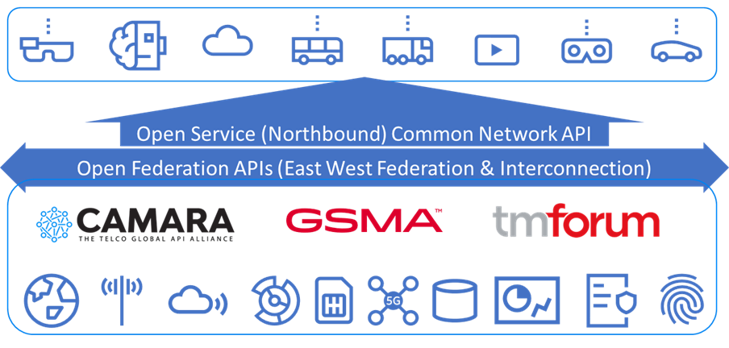
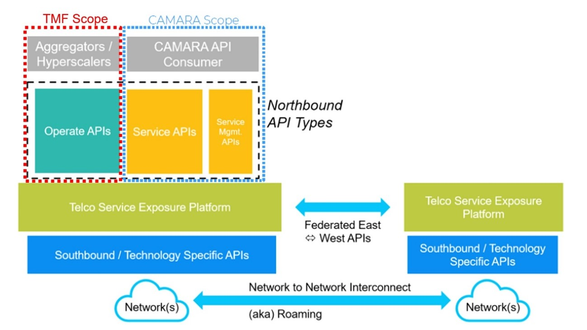
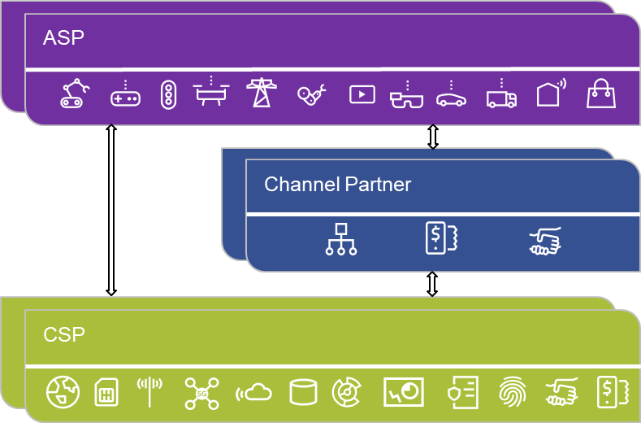
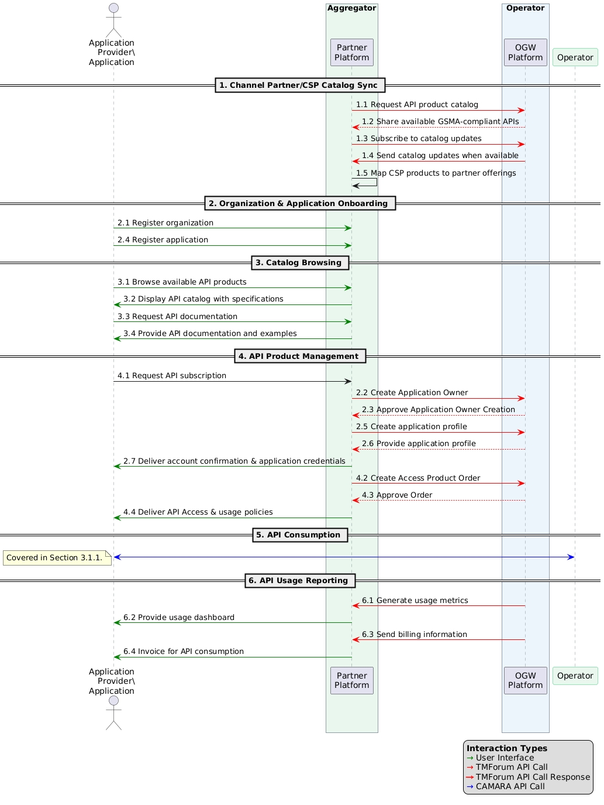
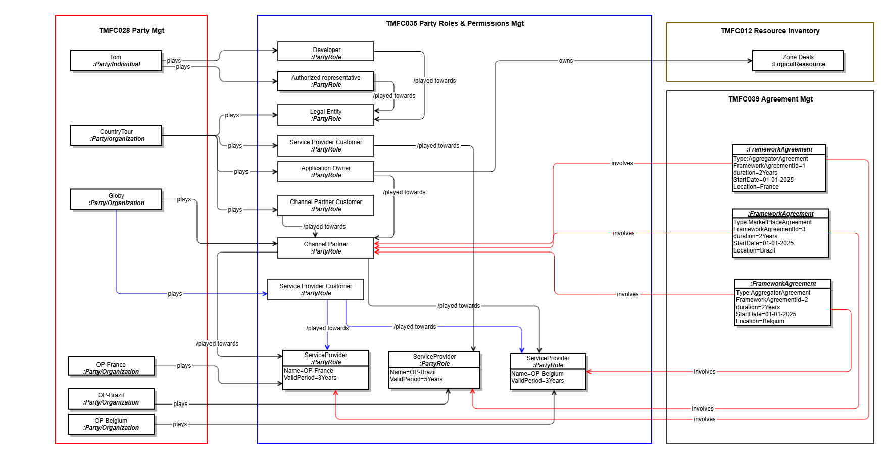
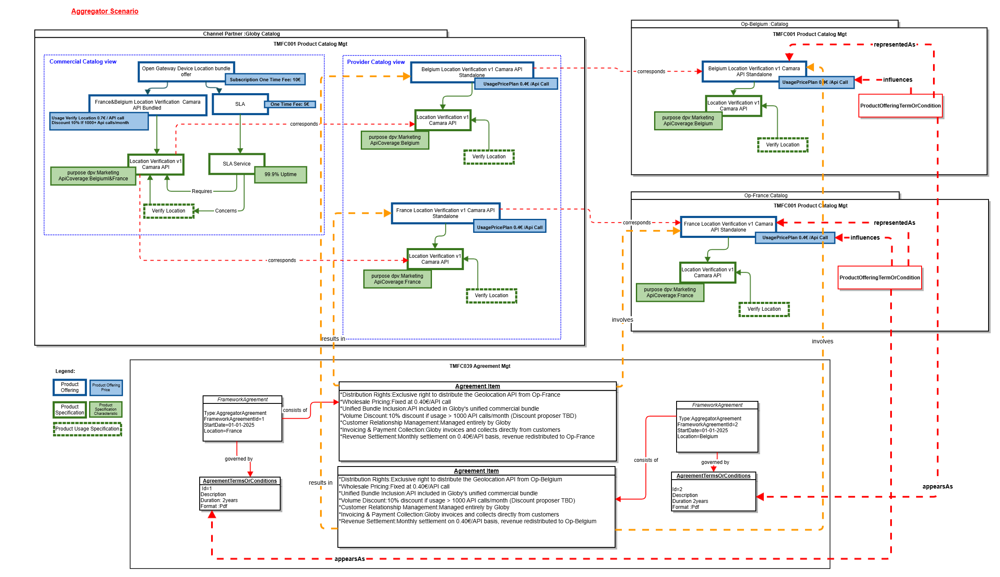
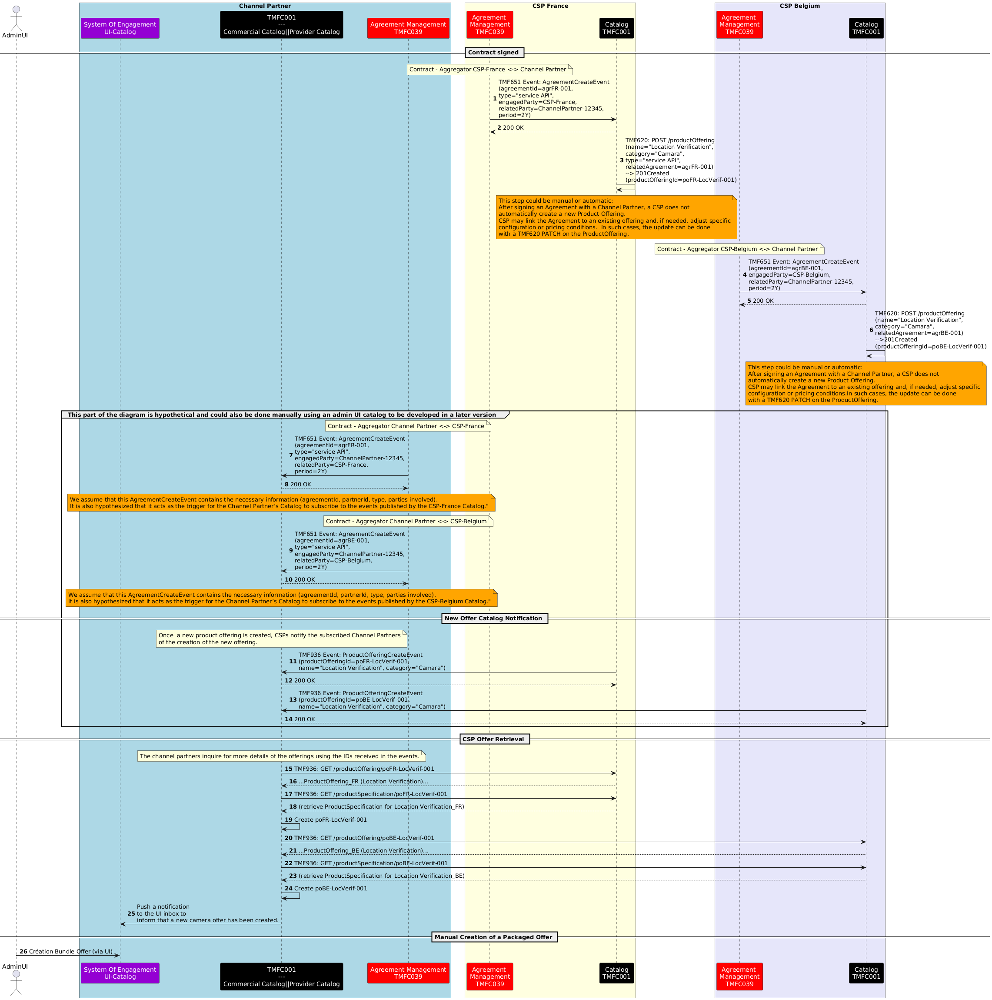
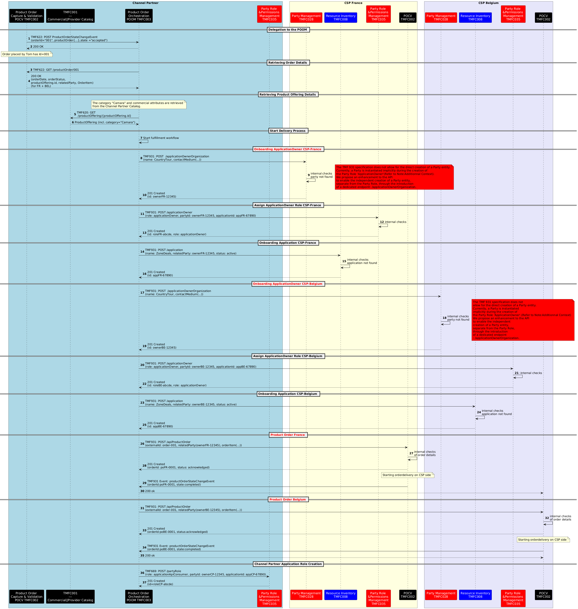
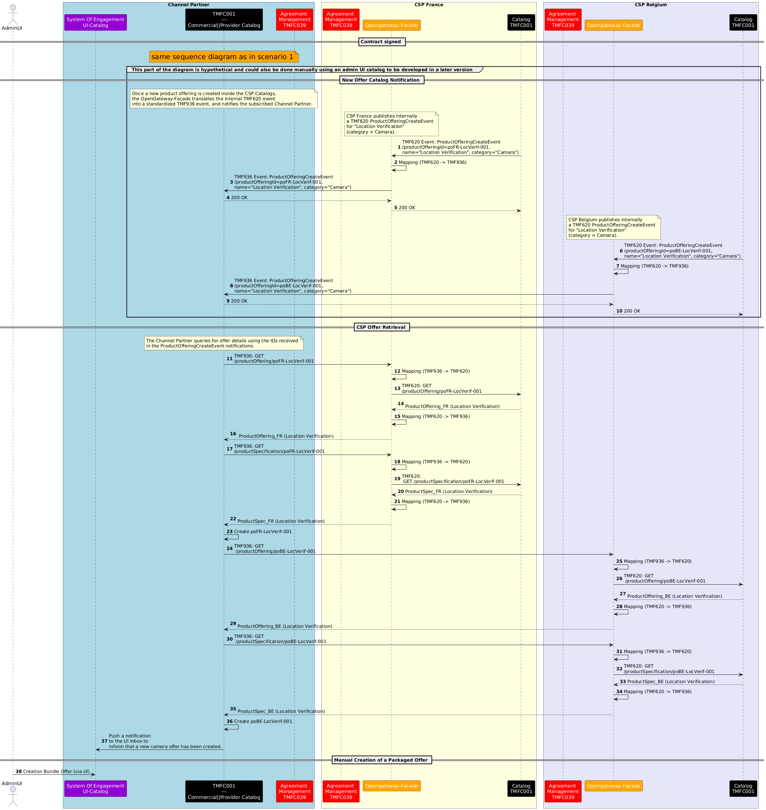
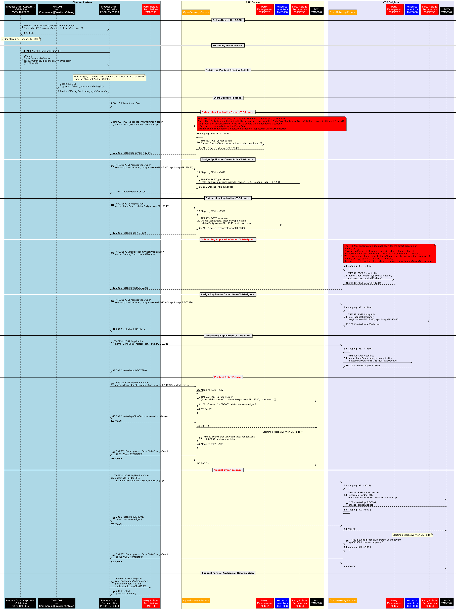

# Executive Summary

This use case demonstrates how a Channel Partner can commercialize CAMARA-based Service API products supplied by multiple Communications Service Providers using TM Forum Open Gateway Operate APIs. It examines two commercial models: an Aggregator model, in which the Channel Partner combines CSP offers into a unified product and manages the end-customer relationship, and a Marketplace model, in which the CSP retains control of its product, pricing, and commercial terms while the Channel Partner provides marketplace and invoicing capabilities. 

The scenario follows a developer acting for an Application Owner who subscribes an existing application to a Geolocation API offer. It describes the supporting catalog, party, application, agreement, and product-order information, together with the interactions required for catalog synchronization, application onboarding, and API-product ordering. TMF936 is used for Open Gateway product-catalog interactions, while TMF931 supports application-owner onboarding, application registration, role management, and API-product ordering. CAMARA APIs are used for runtime service consumption, which is outside the principal Operate API flow examined by this document.

The analysis identifies alternative implementation approaches for exposing Operate APIs. These include direct exposure by the relevant ODA components and exposure through an Open Gateway façade that maps standardized Operate API operations to internal component APIs. The use case highlights unresolved questions concerning orchestration ownership, party and party-role creation, error handling, and the responsibilities of the façade compared with the underlying CSP components. 

The findings indicate that existing ODA components and TM Forum Open APIs provide substantial support for the scenario, but several areas require further clarification or evolution. These include the component responsible for application or resource onboarding, the representation of agreement items in SID, the relationship between TMF931 and its underlying party, role, resource, and order APIs, and the ownership of failures across façade-based implementations. These impacts require validation with the affected TM Forum projects before the use case progresses to publication.

# Introduction

Open Gateway, a recent initiative within the telco industry, aims to create a standardized framework for APIs. This initiative is crucial for enabling telcos to offer their network capabilities as services that can be easily integrated into digital platforms and applications.

*([text description](media/open-gateway-api-framework-overview.text-description.md))*

**Figure 1. Open Gateway Overview**

GSMA Open Gateway is a framework of common network Application Programmable Interfaces (APIs) designed to provide universal access to operator networks for developers The Framework aims for

- **API Standardization and Interoperability:** By developing standardized APIs, Open Gateway simplifies the integration process for third-party developers. This is essential for creating a seamless digital ecosystem where telcos' services can be easily utilized by various industries, including automotive, healthcare, and smart cities.

- **Accelerating Innovation and Service Delivery:** Standardized APIs enable faster and more efficient service deployment. Telcos can offer services like location-based services, identity verification, and network slicing to developers, who can then build innovative applications that leverage these capabilities.

- **Enhancing Customer Experience:** By exposing network capabilities through APIs, telcos can offer more personalized and responsive services. For instance, APIs can enable real-time analytics and monitoring, allowing telcos to offer improved customer support and proactive maintenance.

GSMA Open Gateway allows operators to expose and monetize telco capabilities to third party service providers in a programmatic manner through Application Programming Interfaces (APIs). These APIs pave the way for transforming telco networks into programmable service platforms, enabling the integration of the network with third-party applications, with frictionless interactions between them.

Open Gateway defines the APIs Exposed by CSPs to fulfill the Open Gateway requirements in the categories below.

*([text description](media/open-gateway-northbound-api-types-scope.text-description.md))*

**Figure 2. Open Gateway APIs**

- **Service & Service Management APIs**: Developed within the CAMARA domain. End Consumer (developer) APIs providing a product/service as well as manage/get data about offered services

- **Operate APIs**: Developed within TMForum domain. APIs offering programmable access to Operation,Administration and Management (OAM) capabilities to facilitate the integration of the Open Gateway NaaS Platform with portals, marketplaces and other aggregator platforms

-  **Federated APIs**: Federation between two operators conceptually refers to an agreement to allow exposure of Edge Cloud resources and Network capabilities by the other OP 

- **Southbound APIs**: Raw APIs as defined by various SDOs

This use case is set in the context of commercializing the CAMARA Geolocation Verification API, based on two distinct agreement models between a Channel Partners and several  CSPs: the Wholesale Reseller and the Marketplace Aggregator.

These business models directly influence how the Channel Partner Product Catalog and its Supplier/Partner Product Catalog are designed and represented.

The objective is to illustrate how the TMF Operate APIs support this commercialization logic, using structured views aligned with both the Channel Partner and CSP roles at Framework Agreement and Product Catalog, then Product Order levels. 

This use case will serve as a foundation for further developments, building upon the work initiated within the Operate API working group to ensure a comprehensive approach

## Context

Application Service Providers (ASPs) need to partner with Communications Service Providers (CSPs) for providing network service APIs. These partnerships can either be formed directly with the CSP or through intermediary channel partners like aggregators or hyperscalers.

Each approach offers unique benefits and challenges, depending on the ASP's goals and strategic priorities**.**

*([text description](media/asp-channel-partner-csp-partnering-models.text-description.md))*

**Figure 3. Engagement Models**

### Direct Partnership

In a direct partnership, the ASP engages with the CSP without any third parties. This type of partnership allows the provider to negotiate terms, pricing, and service integration directly with the CSP, offering greater control over the relationship and the services provided. It facilitates close collaboration on product development and the ability to tailor offerings specifically for the provider's needs. However, this approach may require more internal resources for management and negotiation, and the ASP's market reach might be limited to the specific CSP's infrastructure and customer base.

### Partnership via Channel Partners

Alternatively, ASP can collaborate with CSPs through Channel partners such as aggregators or hyperscalers. Aggregators bundle services from multiple CSPs, providing a simpler, one-stop solution for ASPs who want to access a variety of networks and services. Hyperscalers (like AWS or Microsoft Azure) offer additional infrastructure or cloud platforms that complement the ASP's offerings. This approach facilitates broader access to customers and markets, it also simplifies agreement management and integration leading into high scalability. While this option simplifies engagement with multiple CSPs, it comes with trade-offs, including less control over pricing, terms, and customer relationships.

The use case illustrates two business models defined by the GSMA Open Gateway initiative:

- **Aggregator model** where the Channel Partner fully manages the service experience.

- **Marketplace model** where the Channel Partner operates a marketplace platform where CSPs publish and manage their API products individually. Each API offering reflects the CSP’s own pricing and commercial terms. While the Channel Partner may group these offers in an aggregated view for ApplicationOwners for better discoverability, the CSP retains control over the commercial aspects of the product.

To ensure a consistent experience for Application Owners, a unified user experience (UX) layer is typically implemented on the Channel Partner side, abstracting differences between CSPs regardless of the underlying business model. This approach solves the challenge of fragmentation by shielding developers from having to manage multiple CSP-specific integrations and behaviors.

Depending on the agreement model, the end user of the Geolocation API offer may be either a customer of the Channel Partner such as an enterprise developing and commercializing applications or a direct customer of the telecom CSP, when the Channel Partner acts as a marketplace facilitator.

The CAMARA APIs subscribed by the enterprise customer will be consumed by their applications, either explicitly or implicitly, in response to end-user interactions

The use case is focused on the implementation of the TMF Operate APIs, especially which this supporting the onboarding and ordering between Channel Partners and CSPs. This Operate API facilitates interactions between Channel Partners and CSPs by allowing Channel Partners to:

- Subscribe to and manage Service APIs

- Onboard and manage Application Owners

- Create and manage Applications for these Application Owners

## Objective of the use case

The objective of this use case is to illustrate the commercialization of Camara Network APIs by a Channel Partner, who will use the TMF Operate APIs to interact with his suppliers who are Telco operators.

It will permit to illustrate several options related to the ODA components able to provide/expose each Operate API.

The Operate currently assessed for this domain are summarized below, with expected plans for later addition or detailed breakdown of the Operate API functions.

| Function | Description | TMF # | Status |
| --- | --- | --- | --- |
| Application & Developer Management | Enables automation when registering developers and onboarding their Applications through Aggregator/Aggregator portal. Operators shall provide the capability for Aggregators to request the registration of ASPs and the onboarding of their Applications. This includes the end-to-end lifecycle management including validation of the legal entity, modification of existing Applications or management of T acceptance. | TMF 931 | Published |
| API Catalogue Management | Provides a standard catalogue among Operators and Aggregator to align the lifecycle management of the Service APIs. Operators shall provide the capability for Aggregators to manage (CRUD) Service APIs building up the North Bound Open Gateway. Catalogue synchronization is needed, so that Channel Partners can keep up-to-date list of Service APIs made available for consumption to the developers | TMF 936 | Published |
| Usage Reporting | Definition of a unified way to report usage information of the Service APIs, so that Aggregators can make it available to the developers accordingly. Information related to consumption of Service APIs is managed by Operators, who are the ones having an end-to-end view of the services and network resources. This information is exposed towards Aggregators for consolidation and billing management. | TMF 937 | Planned |
| Service Assurance | Enabling a common framework for supervision activities over Service APIs. Operators need to provide developers and Aggregators the capability to supervise the status of running Service APIs, using appropriate performance management (e.g., monitoring) and fault management (i.e., issue/ticket management) mechanisms. | Planned | Planned |

**Table 1. Operate Functions Assessment**

The E2E journey for Service API exposure, once an agreement is established between a CSP and a Aggregator, consists of six distinct phases that represent the complete lifecycle of Service API management and consumption

The following diagram showcases the flow covering operational setup of Aggregator and CSP Catalogues, onboarding, ordering, consumption, and usage reporting capabilities. The elaboration shows the segregation between the TM Forum supported operational phases and CAMARA supported runtime phase.

Note: Service assurance is expected as a future domain within the journey, more information can be included once requirements and solution are ready.

*([PlantUML source](media/service-api-exposure-e2e-journey-sequence.puml))*

**Figure 4. E2E Journey for Service API**

### Aggregator/CSP Catalogue Sync

This phase covers the synchronization of Service API product information between the CSP and Aggregator platforms, ensuring that the Channel Partner has an up-to-date catalogue of available network capabilities.

The capabilities required for information sharing for this phase are covered by TMF936 Open Gateway Product Catalog API

### Organization & Application Onboarding

This phase covers the registration of developer organizations and their Applications in both the Aggregator and CSP systems, establishing the identities and relationships necessary for Service API access. Initial ASP and Application information is captured by the Aggregator but not propagated to any CSP until an initial Service API is requested by for an Application from that specific CSPs.  from that specific CSPs.

Information capture is managed by the Aggregator and no Operate APIs are required to pass the information to the CSP at this phase.

### Catalogue Browsing

This phase depends on the catalogue being synchronized before the browsing and allows developers to explore the available Service API offerings through the Aggregator's interface, reviewing specifications and documentation to select suitable Service APIs for their Applications.

Catalogue browsing by the developer is managed by the Aggregator and no Operate APIs are required to pass the information at this phase.

### Service API Product Management

This phase covers the subscription process where developers request access to specific APIs and receive the necessary credentials to make Service API calls. Information is captured and maintained by the CSP related to Application and Application Service Provider, as well as the selected Service API, it’s pricing model, purpose of use, etc.

The capabilities required for information sharing for this phase are covered by TMF931 Open Gateway onboarding and ordering component suite API

### Service API consumption

This phase covers the actual use of the Service APIs, including the authentication flow and subsequent Service API calls as described in CAMARA documentation. No TMForum APIs are utilized for that phase.

### Service API Usage Reporting

This phase covers the tracking, reporting, and billing of Service API usage, providing visibility to all parties and enabling proper monetization of the API ecosystem. 

The capabilities required for information sharing for this phase are covered by TMF937, which is still a work in progress.

## Scope and assumptions

### Scope

This use case describes a simple interaction scenario involving key players:

- A developer (Tom) who manages the application "ZoneDeals"

- A channel partner (Globy)

- Tom works at Country-Tour, a company interacting with the ecosystem through the Channel Partner. Depending on the agreement model, Country-Tour may either be a direct customer of the Channel Partner (in the Aggregator model) or a customer of the CSP (in the Marketplace model).

- 3 telecom CSPs **Op-Brazil**,** Op-France**, **Op-Belgium** that offer packaged Telco API services.

The scenario will illustrate two agreement models between the channel partner Globy and the different telecom CSPs: **Aggregator Model** and **Marketplace Model.** Then it will present the resulting catalog views for the channel partner and its customers.

And it will describe an order capture made by Tom on behalf of his company Country-Tour.

The delivery of this order, the usage and billing of the ordered products will be described in next versions of the use case or a subsequent use case .

### Assumptions

The following assumptions outline the key differences in how Globy operates under the Aggregator and Marketplace models for the commercialization of network APIs, using the Geolocation API as an example. In this use case, the commercial name of the API is 'Geolocation,' but it relies on the CAMARA specification of the Location Verification API

For the purposes of this use case:

- Globy acts as the Channel Partner and marketplace operator.

- Op-France, Op-Belgium and Op-Brazil act as API Providers (CSPs) and expose CAMARA API products.

- Country-Tour acts as the Application Owner and consumes API products through its application ZoneDeals.

- Tom acts on behalf of Country-Tour as a developer and initiates onboarding and ordering activities.

- In the Aggregator model, Country-Tour is a customer of Globy, while Globy is a customer/partner of the participating CSPs.

- In the Marketplace model, Country-Tour remains a customer of the CSP providing the API service, while Globy acts as a marketplace operator and commercial intermediary.

**Aggregator Model with (Belgium & France): **

- The Channel Partner Globy will bundle a Geolocation Offer that provides access to geolocation services in both France and Belgium, including:

- SLA service (99.9% uptime)

- Usage-based pricing per API call

- One-time fee

- The offer will be based on CAMARA APIs provided by the local CSPs (Op-Belgium in Belgium and Op-France in France).

- Globy will act as the main provider of the bundled geolocation service to the end customer.

**Marketplace Model with (Brazil):**

- The Channel Partner will act as a broker, integrating the Geolocation API from Op-Brazil.

- The geolocation API will be offered as part of the Geolocation API product, maintaining the CSPs’ independent pricing and commercial terms.

- Globy will manage billing on behalf of the CSP and take a commission when it commercializes and invoices the service.

|   | Aggregator Model with (Belgium & France) | Marketplace Model with (Brazil) |
| --- | --- | --- |
| Catalog Management | Assumes a single offer managed by Globy. | Assumes that individual APIs are commercialized by each CSP. |
| Pricing | Assumes that Globy sets a fixed price for the bundled offer. | Assumes that each CSP sets its own pricing. |
| Commercial Relationship with End Customer | Assumes that Globy is responsible for managing Country-Tour relationship. | Assumes that the CSP is responsible for managing Country-Tour relationship. |
| Billing | Assumes that Globy bills Country Tour directly. Globy invoices and reverses part of the revenue to CSPs based on the agreement. | Assumes that Globy bills on behalf of the CSP and takes a commission (for commercialization and invoicing). Billing is handled based on the agreement. |

**Table 2. Agreement Model Exemplified**

- This use case enables an existing application "ZoneDeals" already onboarded and managed by an ApplicationOwner(CountryTour) to subscribe to Geolocation API provided by channel partner and one or more Communication Service Providers (CSPs):

- ApplicationOwner :CountryTour is already registered with the Channel Partner 

- Application is onboarded and approved.

# Description

Scenario Overview:

The commercialization of the Geolocation API is structured through two distinct agreements between the Channel Partner (Globy) and the local mobile CSPs. Each agreement follows a different business model—Aggregator and Marketplace—defining how the API is priced, distributed, and invoiced.

- **Commercial Agreements Overview:**

The table below summarizes the two different agreements between the Channel Partner (Globy) and the local mobile CSPs, outlining their respective commercialization models, pricing strategies, and invoicing processes.

| Agreement Model | Aggregator Model (Belgium & France) | Marketplace Model (Brazil) |
| --- | --- | --- |
| Business Model | Globy acts as the exclusive distributor of the Geolocation API from Op-Belgium and Op-France. | Globy acts as a broker, listing Op-Brazil's Geolocation API on its marketplace. |
| Offer | A single, unified bundle managed and priced by Globy. | Each CSP publishes its own API separately. |
| Pricing | Fixed pricing set by Globy: One-time fee: 10€ Usage-based fee: 0,70€ (centimes)per API call SLA fee: 5€/month | Price set by Op-Brazil One-time fee: 5€ Usage-based fee: 0.40€ per API call |
| Pricing | Fixed Price set by Op-France &Op-Belgium for Globy Usage-based fee: 0.40€ per API call | Globy's commission on the order : 1€ Globy's commission per invoice: 0.50€ |
| Special Commercial Terms | Volume discounts :10% off for 1000+ API calls/month | Seasonal discounts :10% during summer |
| Customer Relationship | Managed by Globy (Globy is the main point of contact for customers).(Customers of Globy) Country Tour is Globy customer , Globy is the CSPs customers | Managed by Op-Brazil(Customers of Op-Brazil) Globy invoices and takes a commission. Globy is not the CSP Customer CountryTour is the CSP's Customer |
| Invoicing | Globy invoices customers directly Globy collects payments | Globy invoices Country Tour on behalf of Op-Brazil on a monthly basis and retains a commission for each transaction, as defined in the Marketplace Agreement. |
| settlement | Settlement over a one-month period calculated based on 0.40€ per API call. Redistributes revenue to Op-Belgium & Op-France based on agreement. | Commission on the order and commission per invoice for Globy. |

**Table 7. Commercial Agreement Overview**

- ** Customer Journey:**

Tom logs into the Globy portal (the Channel Partner) as a Developer at Country-Tour. Depending on the commercial model, Country-Tour may act either as a direct customer of Globy (in the Aggregator model) or as a customer of the CSP (in the Marketplace model). Tom browses the catalog and subscribes to the 'Geolocation API' packaged offer.

Country-Tour** **uses the 'Geolocation API' to track users in real-time in Belgium and France through the Channel Partner, "Globy."

In our scenario, the channel partner is connected with the CSPs in Belgium and France through an Aggregator Model contract, and with Brazil through a Marketplace model contract.

Aggregator Model with SLA (Belgium and France): In addition to the 'Geolocation API', "Globy" offers an additional SLA service to ensure 99.9% availability and response times under 100ms. 

Marketplace Model (Brazil): "Globy" acts as a Marketplace, where the Brazilian CSP exposes its 'Geolocation API' with its own pricing and conditions. Globy takes a commission on each transaction.

*([text description](media/globy-ordering-screen-flow-ui-mockup.text-description.md))*

**Figure 5. Ordering Screen Flow**

# Views

##  Information View

This information model represents the Globy perspective components.

The use case does not currently cover the agreement's setup, it is considered as a pre-existing input.

*([PlantUML source](media/globy-party-agreement-information-model.puml))*

**Figure 6. Party Relationship View**

- The diagrams below details the information models for the channel partner and CSP product catalogs. It also depicts the framework agreements established between them. This information is also considered as pre-existing inputs.

The first modeling illustrates how, by following the Aggregator** agreement model**, the **offer and product catalog views** of the **Channel Partner** as well as the **involved CSPs in France and Belgium** are represented.

*([PlantUML source](media/aggregator-scenario-catalog-agreement-information-model.puml))*

**Figure 7. Product Catalog View in Aggregator Scenario**

The second modeling illustrates how, by following the **Marketplace agreement model**, the **offer and product catalog views** of the **Channel Partner** and the **involved CSP** are represented.

*([PlantUML source](media/marketplace-scenario-catalog-agreement-information-model.puml))*

**Figure 8. Product Catalog View in Marketplace Scenario**

**Note: « AgreementItem » will need to be reconsidered in the evolution of the ABE « Agreement » within the SID.**

- Below is the representation of the Product Order view for the order placed by Tom, on behalf of Country Tour with the Channel Partner Globy. It corresponds to the result of the first version of this use case.

*([PlantUML source](media/tom-country-tour-product-order-information-model.puml))*

**Figure 9. Product Order View in Aggregator Scenario**

Below is the representation of the Product Order view for the order placed by Channel Partner Globy with the CSPs in France and Belgium.

This order enables the application ZoneDeals, managed by the ApplicationOwner Country-Tour, to access geolocation services provided by these CSPs. The API product will be consumed by the ZoneDeals application, which is owned by  Country-Tour, to deliver location-based experiences to end users for marketing purposes.

*([PlantUML source](media/channel-partner-csp-product-order-information-model.puml))*

**Figure 10. Product Order View in in MarketplaceScenario**

#  Diagrams

## Sequence diagrams:

In the sequence diagrams, the prerequisites to be considered for the two scenarios described below are:

- **Tom**, as a developer at Country Tour, initiates an order. The following assumptions are made:

- He is already known by the Channel Partner as:

- An identified individual

- A person with a digital identity

- A representative of Country Tour (role)

- **Country Tour** is recognized as:

- A legal entity

- An application owner

- **Zone Deals** is considered as a logical resource.

### Aggregator Scenario

- The Channel Partner’s POOM component orchestrates the delegation of the order delivery by directly interacting with the CSP France and Belgium components.

- The Channel Partner’s POOM component moreover orchestrates information creation prerequisites to the order delivery on CSP side (Party, PartyRole ...) 

- The CSP- Catalog Management component (TMFC001) exposes the TMF936 (Product Catalog API)

-  while CSP-( Party Management (TMFC028), Resource Inventory (TMFC008), Party Role & Permission Management (TMFC035), and Product Order Capture & Validation (TMFC002) each expose only the relevant resource-specific parts of the TMF931 (Onboarding and Ordering API.))

**Assumptions: **

- The onboarding of the application and its Application Owner takes place during the fulfillment of the first order placed by Tom, acting as the representative of Country Tour

- The CSP exposes an **API Gateway** that serves only as a simple **routing layer** (Not presented in the sequence diagram).

*** Contract & Catalog Sync Notification:***

This sequence describes how a Channel Partner integrates CSP offers into its commercial catalog through agreements, catalog synchronization, and packaged offer creation.

AGREEMENT SETUP:

- Contracts are signed between the Channel Partner and CSPs (France & Belgium)

- Agreement events (TMF651 AgreementCreateEvent) notify catalogs on both sides

- Each CSP creates product offerings linked to the specific agreements

- Channel Partner subscribe to event published by CSP Catalog

OFFER NOTIFICATION:

- When CSPs create new offers, they notify the Channel Partner via TMF936 ProductOfferingCreateEvent

- Notifications include offer IDs and basic information

OFFER RETRIEVAL:

- The Channel Partner queries CSP catalogs using TMF936 GET (ProductOffering and ProductSpecification)

- Retrieves detailed information about the new offers from both CSPs

UI NOTIFICATION:

- The system pushes notifications to the UI inbox

- Informs administrators that new CAMARA offers have been created and are available

BUNDLE CREATION:

- The Channel Partner admin manually creates a packaged/bundled offer

- Combines CSP France and Belgium offers into a single commercial offering

*([PlantUML source](media/scenario1-contract-catalog-sync-notification-sequence.puml))*
**Figure 10. Contract and Catalog Syncronization Sequence Diagram in Aggregator Scenario**

***Tom submits the order on the channel partner's website:***

This section will cover a standard order capture process, which is detailed in **TMFS003**.

Tom (Country Tour) authenticates, browses available API offers, and submits a product order via the Channel Partner platform, using TMF Open APIs. The steps involved are:

- Authentication:

- Catalog Browsing:

- Order Confirmation:

- Order Creation:

Notes:

- No qualification or configuration of offers is performed .

- Authentication ensures that Tom’s identity, roles, and permissions are verified before catalog access.

***Product Ordering and Application Onboarding:***

The following part of the diagram illustrates how a Channel Partner orchestrates a multi-country API product order with CSP France and CSP Belgium using TMF APIs.

- Order initiation: The CP’s POCV sends a ProductOrderCreateEvent (TMF622) to the POOM, which retrieves order details and triggers the fulfillment workflow.

- Onboarding in CSP France: An ApplicationOwnerOrganization is created (TMF931), followed by a role applicationOwner creation and the ZoneDeals application (TMF931). 

- Onboarding in CSP Belgium: The same sequence is repeated – owner, application, then role creation.

- Product ordering: The CP’s POOM sends POST /apiProductOrder (TMF931) requests to FR POCV and BE POCV. Both CSPs confirm the orders and emit productOrderStateChangeEvent.

- Finalization: The CP assigns the role applicationApiConsumer (TMF669) to the ZoneDeals app to enable API consumption.

 Note :

- The TMF931 specification does not allow for the direct creation of a Party entity. Currently, a Party is instantiated implicitly during the creation of the Party Role "applicationOwner."

We propose enhancing the API to enable the independent creation of a Party entity, separate from the Party Role, through the introduction of a dedicated endpoint: "/applicationOwnerOrganization."

*([PlantUML source](media/scenario1-product-ordering-application-onboarding-sequence.puml))*
**Figure 11. Order Orchestration by a Channel Partner for a multi-country API product order in Aggregator Scenario**

###  Marketplace Scenario

- The Channel Partner interacts exclusively with the CSP through the Open Gateway façade, using the standardized TMF931 (Onboarding & Ordering) and TMF936 (Product Catalog) Operate APIs.

- The Channel Partner’s POOM component orchestrates the delegation of the order delivery  interacting via facade with the CSP France and Belgium components.

- The Channel Partner’s POOM component moreover orchestrates informtaion creation prequisites to the order delivery on CSP side (Party, PartyRole ...) 

- The façade does not implement any business process, it serves purely as a technical translation layer. It maps the external TMF931 and TMF936 requests to the appropriate internal APIs exposed by each CSP component

- TMF936  used for catalog discovery, mapped internally to the CSP’s TMF620 Product Catalog API

- TMF931 used for both onboarding and ordering, mapped internally to:

- TMF632 Party API (for applicationOwner / organization creation).**(proposed as an evolution of the TMF931)**

- TMF639 Resource Inventory API (for application registration as a resource).

- TMF622 Product Ordering API (for product order management).

- TMF669 Party Role API (for assigning roles such as applicationOwner)

 The façade is therefore an interoperability layer, ensuring that channel partners see a uniform interface (TMF936, TMF931), while each CSP can implement it by mapping to its own internal TMF APIs.

Note that even with a façade, the internal TMF API will have to understand the payload from the Operate API. So, in reality, will have to implement the additional attributes added in the Operate API. For instance, the TMF632 Party Management API will have to manage the additional attributes that are not in this TMF632 definition, for instance "dateProtectionOfficer". So, in reality the TMF632 internal API will have to be upgraded to be TMF931 compatible. the difference between an internal API that is able to manage Operate API specificities vs the Operate API itself could be null.Except the fact that the standard internal API manages more contextes that only the Open Gateway context.

**Assumption:** 

- Each CSP exposes an **Open Gateway façade** that only publishes the standardized APIs (**TMF936 for Catalog** and **TMF931 for Onboarding & Ordering**).

- The façade does not carry business processes; it acts strictly as a **technical translation layer**, mapping the Open Gateway APIs to the relevant internal APIs (**TMF620, TMF632, TMF639, TMF622**, etc.).

- *** Contract & Catalog Sync Notification Via Opengateway-Facade:***

*([PlantUML source](media/scenario2-facade-catalog-sync-notification-sequence.puml))*
**Figure 12.  Contract and Catalog Syncronization Sequence Diagram in Marketplace Scenario**

- ***Tom submits the order on the channel partner's website:  ***

This section will cover a standard order capture process, which is detailed in **TMFS003**.

Tom (Country Tour) authenticates, browses available API offers, and submits a product order via the Channel Partner platform, using TMF Open APIs. The steps involved are:

- Authentication:

- Catalog Browsing:

- Order Confirmation:

- Order Creation:

Notes:

- No qualification or configuration of offers is performed .

- Authentication ensures that Tom’s identity, roles, and permissions are verified before catalog access.

- ***Product Ordering and Application Onboarding Via Opengateway-Facade:***

*([PlantUML source](media/scenario2-product-ordering-application-onboarding-sequence.puml))*
**Figure 13. Order Capture in Marketplace Scenario**

**NOTE :Additional Context – GSMA Approach**

- In the GSMA reference approach, only a single operation is exposed to the Channel Partner : the creation of the partyRole ApplicationOwner (via TMF931) that contains the Party information by value.

This has been a choice of Operate API team in order to reduce the number of endpoints and API calls by the Channel Partner. This is not consistent with the TMF669 Party Role API that doesn’t allow to pass the engagedParty by value, but only by reference.

- The CSP is responsible for creating the party internally, using its own orchestration layer, before assigning the partyRole.

- The sequence diagram for this “orchestrated Open Gateway-facade” scenario could be developed in a future version of this use case, as a main reference scenario complementing the two existing ones (direct exposure and simple façade translation).

- Or we can also imagine a scenario that envisions sending a single consolidated Product Order request from the Channel Partner to the CSP, which would then handle the creation of all prerequisite entities (Party, PartyRole, Application) and execute the order as part of the same process.

# Conclusion

## Lessons learned

The analysis demonstrated that CAMARA API commercialization can be supported using existing ODA components and Open Gateway Operate APIs. However, the use case also revealed several areas where architectural responsibilities, component ownership and implementation approaches require further clarification.**Open Gateway Façade Responsibilities**

The use case introduces an Open Gateway Façade exposed by CSPs towards Channel Partners. The façade provides a standardized TMF931 and TMF936 interface while interacting with native APIs exposed by underlying ODA components. While the use case demonstrates the feasibility of this approach, the exact responsibilities of the façade remain unclear, particularly regarding orchestration, lifecycle coordination and error management. 

Note: The concept is similar to what has been discovered also in TMFS018 Wholesales Broadband and other B2B2X scenarios that should be aligned.**Application Resource Onboarding**

The onboarding of an Application Resource emerged as a significant architectural topic. Applications are externally owned resources that must be registered, approved and managed within the CSP domain before API consumption can occur. One implementation approach identified in the use case relies on the Channel Partner POOM component creating prerequisite entities such as Party, PartyRole and Application Resources on the CSP side. Alternative approaches are also possible, including delegation of these responsibilities to CSP components. The use case highlights the need for clearer guidance regarding ownership and lifecycle management of externally owned Application Resources.**Boundary Between TMF931 and Underlying ODA Components**

The analysis revealed uncertainty regarding the allocation of responsibilities between TMF931 Operate APIs and the underlying ODA components used by CSP implementations. Further clarification may be required regarding the creation and lifecycle management of Application Owners, Application Resources and the relationship between Operate API resources and the underlying Party, PartyRole, Resource and Product Order domains. **Multi-Party Ownership and Error Handling**

The Aggregator and Marketplace scenarios revealed unresolved questions regarding accountability across Channel Partners, CSPs, Open Gateway Façades and underlying ODA components. In particular, responsibility for error handling, retries, compensation actions and status management remains unclear when onboarding and ordering activities span multiple parties. **Future Investigation**

The analysis identified additional implementation approaches that merit further investigation in future versions of the asset. In particular, further elaboration is required for approaches that rely on existing TMF931 implementations where onboarding activities are exposed through a consolidated operation while orchestration and creation of prerequisite entities are handled behind the API boundary.

## Impacts identified

Document impacts identified during the analysis of the use case. Impacts may relate to APIs, ODA Components, Information Models, Use Cases, External Standards, or other relevant assets. Where follow-up work exists or has been identified, include references to the relevant work items in JIRA.

| Asset Type | Asset | Impact Description | Related Work Item(s) |
| --- | --- | --- | --- |
| ODA Component | Application/Resource Onboarding | Clarify ownership and lifecycle management of externally owned Application Resources. | [TAC-1379] Need components for Resource onboarding - TM Forum JIRA |

**Table 8. Impacts Identified**

