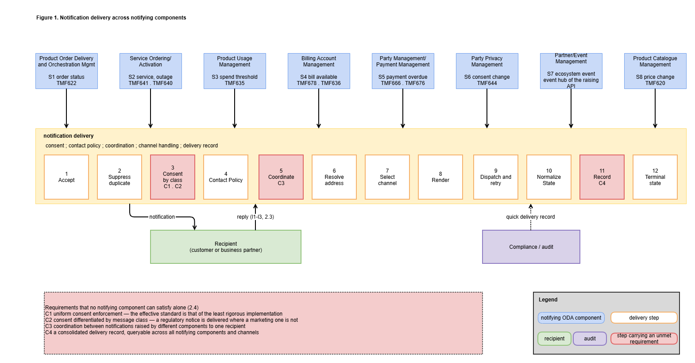
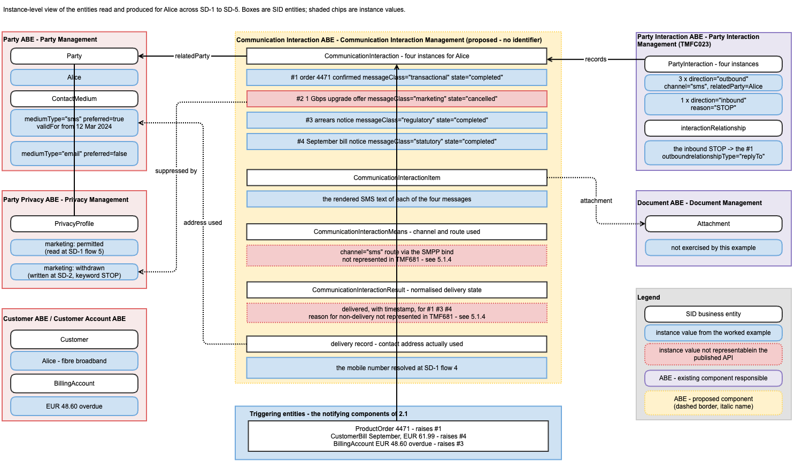
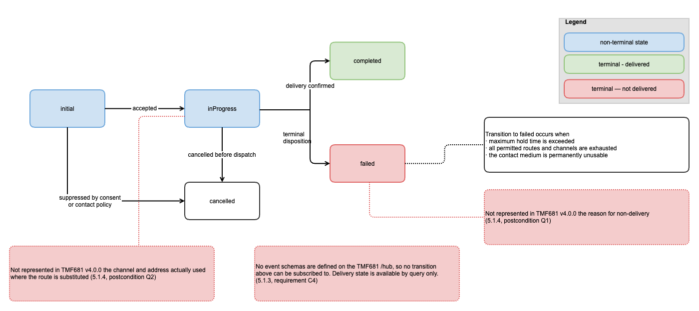
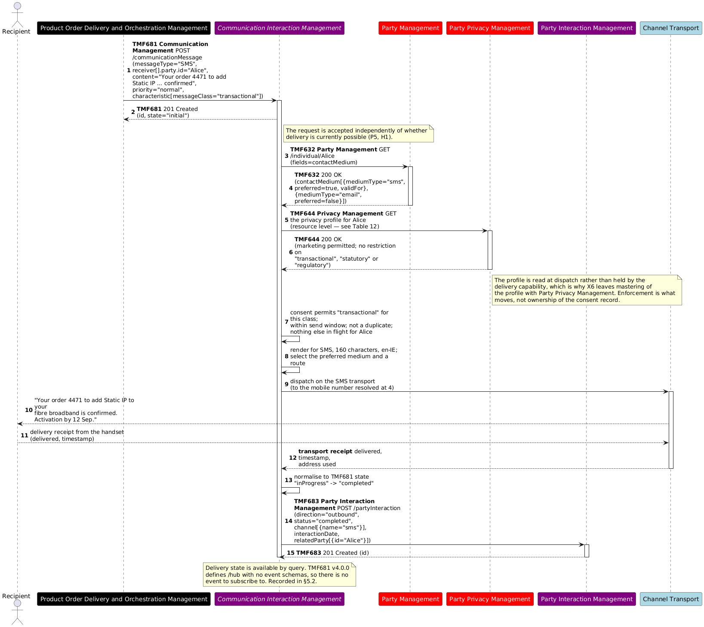
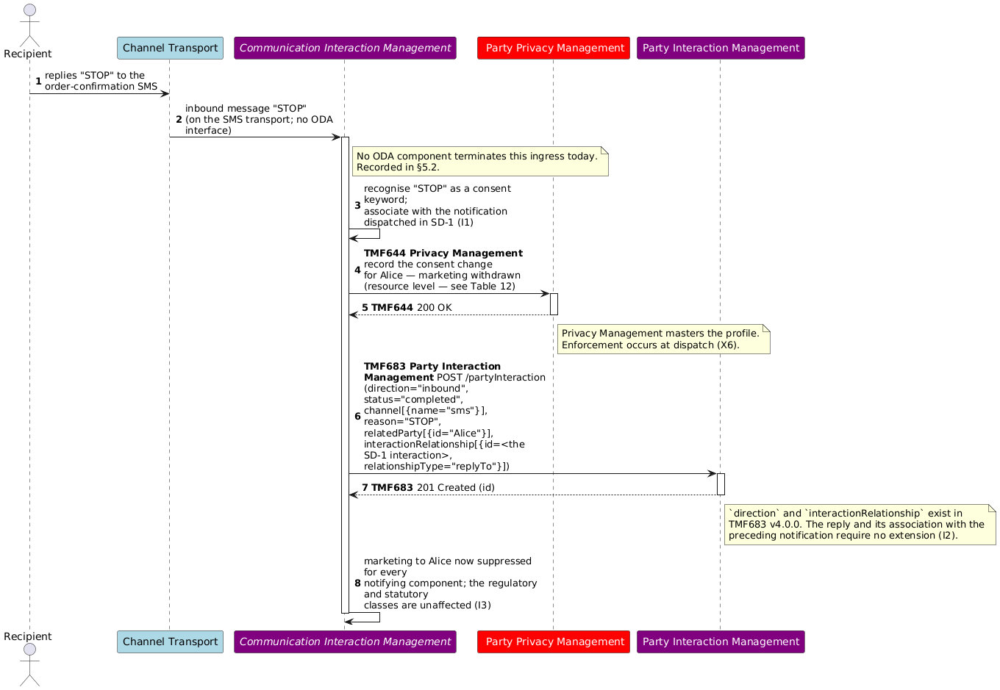
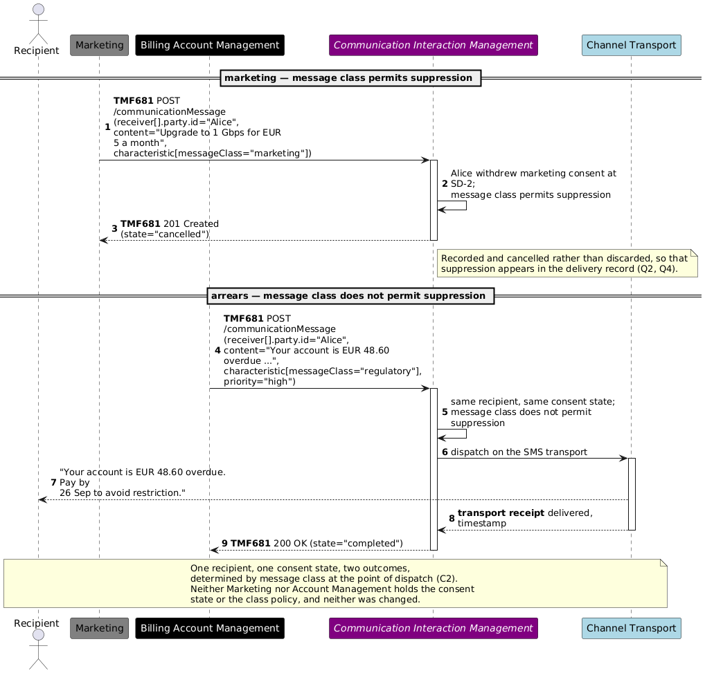
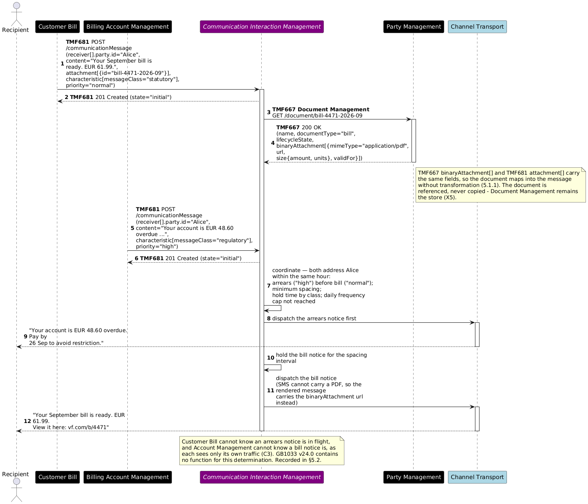
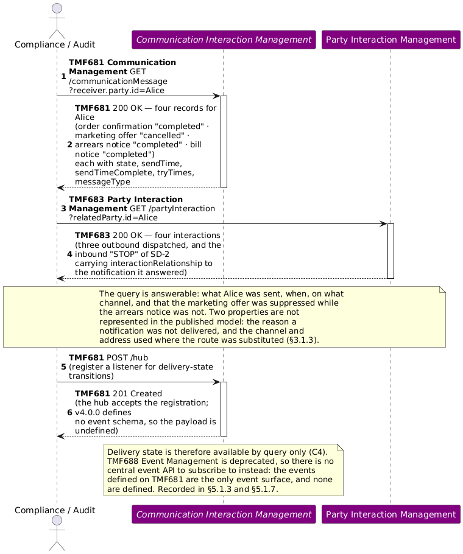
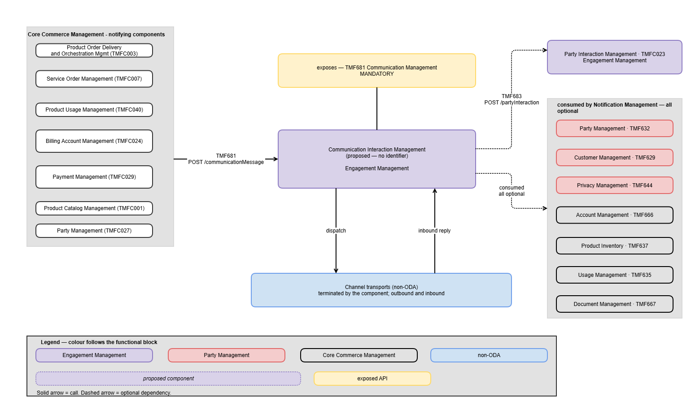

# Executive Summary

Across an ODA implementation many components need to notify (We are talking about comms sent to customers here, not system to system notifications) a customer or a business partner. Product Order Delivery and Orchestration Management notifies on order status, Usage Management on a spend threshold, Customer Bill on bill availability, Account Management on an overdue payment, Privacy Management on a consent change, Partner Management on an ecosystem event. Each is a different business trigger, and each is delivered by the same means: a message to a person, over a channel, subject to that person's consent and contact preferences, with a record of what was sent.

Today each notifying component implements that delivery itself. This use case examines the delivery being consolidated instead — one capability any component can call, which applies consent, contact policy, channel selection, retry and delivery recording uniformly on behalf of all of them.

The use case describes the notification scenarios common to an ODA implementation, the inbound direction when a recipient replies, and the interactions between components in each case. It then records what the current TM Forum asset set does and does not provide for them. The result is uneven, and the unevenness is the principal finding.

| TM Forum asset | State against these scenarios |
| --- | --- |
| eTOM GB921 | The activities exist — 1.3.5.5 Notify Customer and 1.6.9.2 Notify Business Partner |
| SID GB922 | The information exists — the Communication Interaction ABE carries the entities produced |
| Open APIs | Sufficient — 15 of the 16 APIs involved are used unchanged; TMF681 Communication Management already models the delivery contract |
| Functional Framework GB1033 | One function of approximately twenty required, and it is claimed by no component |
| ODA component inventory | No component exposes TMF681. TMFC023 Party Interaction Management declares it as a dependent API |

**Table 1. State of TM Forum assets against the notification scenarios**

The frameworks that describe this capability are complete. The frameworks that assign it to a component are not.

**Conclusions.** The use case identifies a candidate ODA component, *Communication Interaction Management*, to provide TMF681; approximately twelve additions to the Functional Framework; and three gaps in TMF681 v4.0.0 — no event schemas on the /hub resource, no representation of the reason a notification was not delivered, and no representation of the channel and address actually used where the route is substituted. No change is required to eTOM or SID.

**Next steps.** The impacts recorded in 5.2 are raised with the owning projects, beginning with the TMF681 event schemas and the Functional Framework additions, both of which precede the component proposal. A subsequent version extends the scope to bulk notification and the admission control it requires, notification-led purchase intent, and sender identity across multiple brands, as set out in 1.3.1.

# Introduction

Every communication service provider notifies its customers and business partners continuously, from many components, on many channels, under consent and data-protection obligation. The notification is generally treated as a concern of whichever component raised it, and each therefore implements its own address resolution, consent check, channel handling, retry and delivery record.

The consequences are not visible from within any one component. They become visible when the notifications raised by all of them to one recipient are considered together, which is what this use case does.

## Context

**Business context.** Notification of customers and business partners is common to every communications service provider, across all market segments and product lines. It is subject to consent and data-protection obligations in every market, and in some cases — arrears, price change, outage — to an obligation to notify and to evidence having notified.

**Business problem.** Notification is triggered by many components and delivered by each of them independently. The effects are:

- **Inconsistent enforcement.** Consent and contact policy are applied as each notifying component implements them, so the effective standard is that of the least rigorous implementation.

- **No coordination between notifications.** No component sees notifications raised by another component to the same recipient, so ordering, spacing and frequency across all traffic to one recipient are not governed.

- **No owner for the inbound direction.** When a recipient replies to a notification, including with a consent keyword, no component is responsible for receiving it, interpreting it, and applying the result across all notifying components.

- **No consolidated delivery record.** Delivery evidence is held per notifying component and per channel, so the question *was this recipient notified, when, and at what address* has no single answer.

- **Duplicated build and operation.** The same delivery capability is built once per notifying component, and then operated, monitored, patched and re-certified once per notifying component.

**Proposing workgroup.** Proposed to the **End-to-End ODA** project, based on that project's asset set: the ODA component inventory (IG1242), the TM Forum Open API suite, eTOM GB921, SID GB922 and Functional Framework GB1033.

**Current situation the use case intends to clarify.** The TM Forum frameworks address notification partially. eTOM defines the activity, SID defines the information, and TMF681 Communication Management defines the API. The Functional Framework decomposes the capability into a single function, and no published component claims that function or exposes TMF681. TMFC023 Party Interaction Management declares TMF681 among its dependent APIs, so the asset set contains a consumer of communication and no provider of it. This use case examines whether that is a deliberate boundary or a gap.

## Objective of the use case

### Target Audience

| Audience | Knowledge Level | Use |
| --- | --- | --- |
| Enterprise and solution architects | business and technical | where notification delivery belongs in an ODA architecture |
| ODA component and Open API owners | technical | the boundary against TMFC023, Party, Privacy and Product Order, and the TMF681 gaps identified |
| Compliance and regulatory functions | business | how consent and evidence-of-notification obligations are met by architecture rather than per system |
| Software vendors implementing ODA | technical | the scope of a capability currently implemented within each notifying component |

**Table 2. Target audience**

Operator categorization, per IG1363: a ServCo concern. It has no NetCo or InfraCo content beyond the channel transports it terminates.

### Business problems addressed, and business value.

| Value | Mechanism |
| --- | --- |
| Consistent consent and contact-policy enforcement | one enforcement point applied to all notification traffic on every submission path |
| Evidence of notification | one delivery record across all notifying components and all channels |
| Coordination across notifying components | ordering, spacing and frequency governed across all traffic to one recipient |
| Reduced cost to build | the delivery capability is adopted once rather than implemented per notifying component |
| Reduced cost to operate | one system to operate, monitor and support; one integration per channel rather than one per notifying component per channel |
| Faster delivery of notifying components | a notifying component integrates one API and inherits governance |

**Table 3. Business value and the mechanism that delivers it**

The scenarios span the **Order to Activate**, **Usage to Payment** and **Request to Answer** value streams. Capability identifiers are to be confirmed against GB1029C.

### User Story

- As a **customer or business partner**, I need the messages an operator sends me to respect the preferences I have expressed and the channel I have chosen, so that I can rely on the messages that require my action.

- As an **operator compliance owner**, I need one record of what was sent to a recipient, when and by what means, across every notifying component and channel, so that I can evidence compliance without reconciling multiple systems.

- As an **architect of a notifying component**, I need to request a notification and have consent, contact policy, channel selection, retry and recording applied on my behalf, so that I do not implement them again.

Of the two objective types the template distinguishes, this use case is both. It addresses a business problem, and in doing so it examines the boundaries and interactions of a capability not present in the component inventory, so that the capability can subsequently be detailed.

## Scope and assumptions

### Scope

In Scope

| # | Included |
| --- | --- |
| S1 | The notification scenarios of 2.1 — the delivery of each notification, not the business event that triggers it |
| S2 | Consent and contact-policy enforcement at the point of dispatch, differentiated by message class |
| S3 | Coordination between notifications raised by different components to the same recipient |
| S4 | The inbound direction — receipt of a reply, its association with the originating notification, and consent keywords |
| S5 | Delivery state normalised across channels and routes, and the resulting delivery record |
| S6 | Notification of business partners as well as customers, where the delivery is governed identically |

**Table 4. Scope — included**

Out of Scope

| # | Excluded | Owned by |
| --- | --- | --- |
| X1 | The decision whether to notify, and the content of the notification. GB1033 is consistent with this, placing 39 Bill Dispute Customer Notification, 296 SLA Violation Notification and 1341 Product Specification Change Notification in the domains that raise those events | the notifying component |
| X2 | Campaign management, targeting and segmentation | campaign and marketing components |
| X3 | Order lifecycle, fulfilment and order status | Product Order |
| X4 | Mastering of party and customer data, including the customer hierarchy | Party and Customer components |
| X5 | Storage of content assets and documents | Document Management |
| X6 | Mastering of the privacy profile — its definition, amendment and erasure. This use case addresses enforcement at the point of dispatch | Privacy Management |

**Table 5. Scope — excluded, and the owning capability**

**Planned for later releases.** Bulk notification and the admission control it requires; notification-led purchase intent and the hand-off to Product Order; sender identity across multiple brands and hosted operators; the front-end interaction pattern of Approach A and Approach B, which no scenario in this release exercises.

### Assumptions

Actors

| Actor | Type | Role |
| --- | --- | --- |
| Recipient | person | a customer or a business partner; receives notifications and may reply |
| Notifying component | ODA component | determines that a notification is required and requests it |
| Compliance or audit function | person or system | queries the delivery record |
| Channel transport | non-ODA | the bearer for each channel; terminated by the delivery capability and not an ODA interface. Examples below |

**Table 6. Actors**

A channel transport is whatever actually carries the message on a given channel. It is not a TM Forum interface, and it is usually not an ODA component:

| Channel | Channel transport |
| --- | --- |
| SMS | an SMPP bind to a short message service centre, or an aggregator's messaging gateway |
| Email | an SMTP relay, or an email service provider's submission API |
| Mobile app push | the platform notification service for the device — for example APNs or FCM |
| RCS | an RCS hub, or a Messaging-as-a-Platform provider |
| Voice and IVR | a voice platform reached over SIP |
| OTT messaging | the business messaging interface of the OTT provider |
| Print and post | a print-and-mail fulfilment provider |

 **Table 7. Examples of a channel transport**

Two properties are common to all of them and are why they are modelled as an actor rather than as an interface. Each has its own protocol, its own delivery-receipt semantics and its own failure modes, which is what step 7 of 2.2 abstracts and step 10 normalises. And each carries traffic in **both** directions, which is why the inbound direction of 2.3 has no TM Forum interface: a capability that terminates a transport for dispatch already terminates it for receipt.

Preconditions

| # | Precondition |
| --- | --- |
| P1 | The recipient exists as a Party with at least one contact medium, mastered outside the delivery capability |
| P2 | A privacy or consent profile exists for the recipient, mastered outside the delivery capability |
| P3 | The notifying component determines from its own business event that a notification is required |
| P4 | Each notification carries a message class, supplied by the notifying component, which determines whether consent may suppress the notification, whether the channel may be substituted, and how long delivery may be attempted |
| P5 | At least one channel transport is available for at least one of the recipient's contact media |

**Table 8. Preconditions **

Postconditions

| # | Postcondition |
| --- | --- |
| Q1 | Every notification requested has reached a terminal state — delivered, or not delivered with a recorded reason |
| Q2 | A record exists per notification of the contact address used |
| Q3 | A reply from the recipient is recorded as a party interaction, associated with the notification that preceded it |
| Q4 | A consent change expressed by a reply is applied to subsequent notifications from every notifying component, according to message class |
| Q5 | The delivery record can be queried for a recipient across all notifying components and channels |

**Table 9. Postconditions**

**Success conditions.** A notification whose message class permits suppression is not delivered after consent is withdrawn. A notification whose message class does not permit suppression is delivered. Both hold without change to any notifying component.

Working hypotheses

| # | Hypothesis |
| --- | --- |
| H1 | Consent enforcement, contact policy, channel handling and delivery recording are the same concern for every notification scenario, and can be factored out of the notifying components |
| H2 | The decision to notify is specific to each notifying component and is not factored out (X1) |
| H3 | Coordination across notifications (S3) and the inbound direction (S4) require visibility of all notification traffic for a recipient, and are not achievable within an individual notifying component |
| H4 | The existing Open API set is sufficient for these scenarios without new APIs. Examined in 5.1 |

**Table 10. Working hypotheses**

# Description

## Notification scenarios

The scenarios below are those common to an ODA implementation. Each is a different business trigger raised by a different component, and each requires the same delivery.

| # | Scenario | Notifying component | Trigger API | Message characteristics |
| --- | --- | --- | --- | --- |
| S1 | Order status and confirmation | Product Order Delivery and Orchestration Management | TMF622 | transactional; recipient's preferred channel |
| S2 | Service activation, and service outage | Service Ordering, Service Activation | TMF641 · TMF640 | transactional or advisory; outage may address many recipients |
| S3 | Usage or spend threshold reached | Usage Management | TMF635 | advisory; time-sensitive |
| S4 | Bill available | Customer Bill, Bill Presentation | TMF678 · TMF636 | statutory; recurring; may carry an attachment |
| S5 | Payment overdue | Account Management, Payment | TMF666 · TMF676 | regulatory; evidence of delivery required; not suppressible by consent |
| S6 | Consent or preference change confirmed | Privacy Management | TMF644 | transactional; confirms an action the recipient took |
| S7 | Partner or ecosystem event | Partner Management | Event Hub of the raising API | recipient is a business partner; eTOM 1.6.9.2 |
| S8 | Product or price change | Product Catalog | TMF620 | regulatory notice period; addresses many recipients |

**Table 15. Notification scenarios common to an ODA implementation**

## Delivery steps common to every scenario

Each scenario differs in what triggers it, whom it addresses and what it says. Each requires the same sequence of delivery steps.

| Step | Description |
| --- | --- |
| 1 | Accept the notification request, independently of whether delivery is currently possible |
| 2 | Suppress a duplicate request |
| 3 | Determine whether consent permits delivery, given the message class |
| 4 | Determine whether contact policy permits delivery now — send window, quiet hours, frequency |
| 5 | Coordinate against other notifications in flight to the same recipient |
| 6 | Resolve the recipient reference to a contact address, honouring the preferred medium and its validity dates. Not required where the notifying component supplies an explicit address |
| 7 | Select the channel and the route |
| 8 | Render the message for the channel, in the recipient's language, with any required compliance text |
| 9 | Dispatch, and retry within bounds; substitute route or channel where the message class permits |
| 10 | Normalise the delivery outcome to one state model |
| 11 | Record what was sent, to which address, and with what outcome |
| 12 | Bring the notification to a terminal state |

**Table 16. Delivery steps common to every notification scenario**

This sequence is the subject of the use case. It is identical across the eight scenarios of 2.1, and it is currently implemented within each notifying component.

## The inbound direction

A recipient may reply to a notification. The reply arrives on the channel transport that carried the notification, not over a TM Forum interface. Three requirements follow.

| # | Requirement |
| --- | --- |
| I1 | The reply is associated with the notification that preceded it |
| I2 | The reply is recorded as a party interaction, in the inbound direction |
| I3 | Where the reply is a consent keyword, the consent change is applied to subsequent notifications from every notifying component, according to message class |

**Table 17. Requirements arising from a reply**

I3 cannot be met within an individual notifying component. A reply arrives on one channel, in response to one notification, and must take effect for all.

## Requirements not satisfiable by a notifying component alone

Four requirements above cannot be satisfied by a notifying component acting alone, because each requires visibility of notification traffic beyond that component's own.

| # | Requirement | Why a notifying component cannot satisfy it |
| --- | --- | --- |
| C1 | Uniform consent enforcement (S2) | Each notifying component enforces its own interpretation. The effective standard is that of the least rigorous implementation, and no component establishes a common one |
| C2 | Consent differentiated by message class (S2, I3) | Consent withdrawal suppresses some notifications and not others — a regulatory notice under S5 or S8 is delivered, a marketing notification is not. Enforcement therefore depends on the message class of each notification at the point of dispatch, and cannot be represented as a single state that each notifying component reads independently |
| C3 | Coordination between notifications (S3) | A notifying component sees only the notifications it raises. Ordering, spacing and frequency across all traffic to a recipient require visibility of all of it |
| C4 | Consolidated delivery record (S5) | Evidence held per notifying component and per channel cannot answer a query about a recipient across all of them |

**Table 18. Requirements not satisfiable by a notifying component acting alone**

On C2, the consequence of error is bidirectional: a notification that is required is suppressed, or a recipient who has withdrawn consent is contacted. Both are visible to the recipient.

On C4, TMF681 v4.0.0 defines a /hub resource and no event schemas, so delivery-state transitions cannot be subscribed to in a standardised way. Delivery state is available by query only.

## Business process view

*([text description](media/notification-delivery-business-process.text-description.md))*

**Figure 1. Notification delivery across notifying components**

# Views

The Information View is mandatory for End-to-End ODA use cases and is given below. The Value Network/Streams View and the Capability View are not applicable to this use case and have been removed.

## Information View

### Information available at the start

| Information | SID ABE | Read over |
| --- | --- | --- |
| Party, and contact media with mediumType, preferred and validFor | Party | TMF632 individual |
| Customer, where the notifying component references a customer | Customer | TMF629 |
| Privacy and consent profile | Party Privacy | TMF644 |
| Billing account and its contacts | Customer Account | TMF666 billingAccount |
| The business entity the notification concerns — order, product, service, bill | Product Order · Product · Service · Customer Bill | TMF622 · TMF637 TMF640 TMF678 |
| Document referenced as an attachment | Document | TMF667 |

**Table 19. Information read during the use case, and its source**

### Information produced

| Information | SID ABE | Produced at | Represented by |
| --- | --- | --- | --- |
| CommunicationMessage — the notification and its lifecycle | Communication Interaction | request | TMF681 communicationMessage |
| Channel and route used | Communication Interaction | dispatch | not represented in the API — see 5.2 |
| Normalised delivery state | Communication Interaction | outcome | TMF681 state |
| Delivery record, including the contact address used | Communication Interaction | dispatch | TMF681 and TMF683 |
| PartyInteraction — one per notification and one per reply | Party Interaction | dispatch, reply | TMF683 partyInteraction |
| Association of a reply with its notification | Party Interaction | reply | TMF683 interactionRelationship |
| Consent change expressed by a reply | Party Privacy | reply | TMF644 |

**Table 20. Information produced during the use case, and its representation**

The SID Communication Interaction ABE carries CommunicationInteraction, CommunicationInteractionItem, CommunicationInteractionMeans, CommunicationInteractionResult and Notification. CommunicationInteractionMeans corresponds to the channel and route, and CommunicationInteractionResult to the normalised delivery state. No new information model is required.

Shared_Domain / Communication_Interaction_ABE is shared with TMFC023. A SID ABE describes shared data structures rather than responsibility, and more than one component may reference the same ABE.

The view below is drawn at instance level, following the convention used by TMFS002 and TMFS003. It carries the worked example of 4.1 rather than entity types alone, so that the entities produced by the use case can be read as concrete values rather than as a schema.

Each SID entity appears as a box, and the instance values it takes for Alice appear as chips beneath it. The entities are grouped by ABE, and each group is labelled with the component responsible for it: Party with Party Management, Party Privacy with Privacy Management, Party Interaction with TMFC023 Party Interaction Management, Document with Document Management, and Communication Interaction with *Communication Interaction Management*, drawn with a dashed border because it has no identifier.

Three things are visible in the instance values that are not visible in the entity types:

- **The four messages sent to Alice occupy one CommunicationInteraction set**, with their message class and terminal state shown per instance. The suppressed marketing offer carries state="cancelled" rather than being absent, which is what makes the suppression auditable (Q2, Q4).

- **The consent profile appears twice**, once as read at SD-1 and once as written at SD-2, which distinguishes enforcement from mastering (X6).

- **Two chips are marked as not representable in the published API** — the channel and route actually used, and the reason for non-delivery. These are the two gaps recorded in 5.1.4, shown here at the point where the value would otherwise be held.

*([PlantUML source](media/alice-worked-example-instance-information-view.puml))*

**Figure 2. Communication Interaction view — the worked example as SID entities**

### Notification state model

TMF681 v4.0.0 defines the enumeration, adopted without extension:

initial → inProgress → completed | cancelled | failed

Two properties required by the postconditions are not represented in the published model:

- **Reason for non-delivery** (Q1). TMF681 carries tryTimes and state = failed, and no field for the reason — hold time exceeded, routes exhausted, contact medium unusable.

- **Channel and route used** (Q2). receiver[] records the address requested. Where the route or channel is substituted, the address used is not represented.

The diagram shows the five states and their transitions, with the conditions annotated on the transition to failed, and marks the two properties above that the published model does not represent.

*([text description](media/communication-delivery-state-lifecycle.text-description.md))*

**Figure 3. Notification lifecycle**

# Diagrams

Sequence diagrams are mandatory for mature End-to-End ODA use cases and are not required for initial publication. They are included in 4.1. An ODA component interaction view is included in 4.2. Collaboration and Activity diagrams are not included: the interactions they would carry are already visible in the sequence diagrams of 4.1 and the process view of 2.5.

Approach A and Approach B for front-end interaction are not described, as no scenario in 2.1 involves a user interface; every trigger is a business event raised by a component.

## Sequence Diagrams

**Conventions.** ODA components appear as swim lanes with their full name, coloured by functional block per the template's convention: Engagement Management purple, Party Management red, Core Commerce Management black, Production medium blue. Non-ODA elements are pale blue and Canvas or technical functions grey. Arrows are numbered. The component proposed by this use case, having no identifier, is named in italics.

The functional block of each component named, and therefore its colour, is to be confirmed against IG1242.

Message class values shown are illustrative categories, not a proposed enumeration.

**Worked example.** So that the functional content of each flow is concrete, the five diagrams below follow one recipient through one sequence of events.

| Alice has a fibre broadband subscription. She places an order to add an optional static IP address to it. Her Party record holds two contact media — a mobile number marked preferred and an email address — and a consent profile that permits marketing. Over the following weeks she receives the order confirmation, replies STOP, and then receives a bill notice carrying her September bill document and an arrears notice. |
| --- |

| Diagram | What happens to Alice | Message class |
| --- | --- | --- |
| SD1 | Product Order Delivery and Orchestration Management confirms the static IP order confirms the static IP order; Alice is notified by SMS | transactional |
| SD2 | Alice replies STOP to that SMS | inbound |
| SD3 | A marketing offer is suppressed; an arrears notice is delivered | marketing, then regulatory |
| SD4 | A bill notice referencing her bill document and an arrears notice arrive in the same hour and are ordered | statutory, regulatory |
| SD5 | Compliance asks what Alice was sent, and when | — |

**Table 21. The worked example followed through the sequence diagrams**

### SD1 : Notification requested and delivered

The sequence common to all eight scenarios of 2.1, shown with Product Order Delivery and Orchestration Management (S1). The other scenarios differ in the notifying component, the trigger and the message class.

*([PlantUML source](media/sd1-notification-requested-delivered-sequence.puml))*

**Figure 4. Notification requested and delivered**

### SD2 : Reply received and consent applied

The inbound direction of 2.3. Alice replies to the order confirmation of SD-1. The reply arrives on the channel transport that carried it, not over a TM Forum interface.

*([PlantUML source](media/sd2-reply-received-consent-applied-sequence.puml))*

**Figure 5. Reply received and consent applied**

### SD3 : Consent applied by message class

Two notifications to Alice from different components, after the STOP of SD-2. The message class determines the outcome. Neither notifying component changes.

*([PlantUML source](media/sd3-consent-applied-by-message-class-sequence.puml))*

**Figure 6. Consent applied by message class**

### SD4 : Coordination between notifications

The arrears notice of SD-3 does not arrive alone. Customer Bill raises Alice's September bill notice in the same hour, and neither notifying component can see the other's traffic.

*([PlantUML source](media/sd4-coordination-between-notifications-sequence.puml))*

**Figure 7. Coordination between notifications**

### SD5 : Delivery record queried

Compliance asks what Alice was sent, and when.

*([PlantUML source](media/sd5-delivery-record-queried-sequence.puml))*

**Figure 8. Delivery record queried**

## ODA Component & Canvas Interaction Diagrams

A high-level architectural view of the components involved in the notification scenarios of 2.1 and the interfaces between them. The view is organised by ODA functional block, and the component identified in 5.1.2 is shown with a dashed border and an italic name, having no identifier.

Three properties of the view carry the analysis of 5:

- **One exposed API.** The component exposes TMF681 Communication Management and nothing else. Every notifying component on the left consumes that one interface, which is the reuse position of 5.1.9.

- **No mandatory dependency.** Every consumed interface on the right is optional, because a notifying component may supply an explicit delivery address rather than a party reference.

- **The inbound direction is not an ODA interface.** Channel transports are drawn as non-ODA. They are terminated by the component in both directions, which is the observation recorded in 5.1.8.

Party Interaction Management is shown separately from the consumed interfaces because the relationship is reciprocal rather than one-way: it exposes TMF683, which this component consumes, and it consumes TMF681, which this component exposes. See Table 23.

*([text description](media/communication-interaction-management-component-diagram.text-description.md))*

**Figure 9. ODA component interaction**

# Conclusion

## Lessons learned

### Reuse of ODA Assets

The scenarios of 2.1 were examined against GB921 v24.0, GB922 v25.0, GB1033 v24.0 and the published Open API set.

| Asset class | Involved | Reused unchanged | Extension identified | Newly identified |
| --- | --- | --- | --- | --- |
| eTOM business activities | 4 | 4 | 0 | 0 |
| SID ABEs | 10 | 10 | 0 | 0 |
| Open APIs | 16 | 15 | 1 | 0 |
| ODA components | 14 | 13 | 0 | 1 |
| Functional Framework functions | ~20 required | 1 | 0 | 12 |

**Table 22. Reuse of ODA assets across the notification scenarios**

The fourteen ODA components, sixteen Open APIs, four eTOM activities and ten SID ABEs are enumerated in Table 11, Table 12 and Table 14. Reuse is therefore 100% for eTOM and SID, 94% for the Open APIs, 93% for components, and 5% for Functional Framework functions.

**eTOM defines the activities required**, at both customer and business partner level. No contribution arises.

**SID defines the information produced**, in an ABE whose entities correspond to the delivery steps of 2.2. No contribution arises.

**The Open API set is sufficient.** TMF681 CommunicationMessage represents the delivery contract without extension — messageType, sender, receiver[] accepting either an address or a party reference, content, subject, characteristic[], priority, scheduledSendTime, tryTimes, attachment[], logFlag, and state with its five values. TMF683 represents a reply and its association with the preceding notification through direction and interactionRelationship. One extension is identified, concerning TMF681. TMF667 binaryAttachment[] and TMF681 attachment[] are field-identical — id, href, attachmentType, content, description, mimeType, name, url, size and validFor — so a document retrieved from Document Management maps into a notification without transformation, as SD-4 shows.

**The Functional Framework decomposes the delivery sequence into one function.** The other notification-related functions in GB1033 — 39 Bill Dispute Customer Notification, 296 SLA Violation Notification, 1341 Product Specification Change Notification, 583 Activation Notification — each describe a business event that triggers a notification and belong to the domain that raises it, consistent with X1. No function describes channel handling, delivery orchestration, retry or route substitution, consent enforcement at dispatch, coordination between notifications, or the inbound direction.

**No component in the inventory exposes **TMF681**.** TMFC023 declares it as a dependent API.

### No component exposing TMF681 Communication Management

Currently, no ODA component exposes the TMF681 Communication Management API. TMFC023 Party Interaction Management declares TMF681 among its dependent APIs, so the asset set contains a consumer of communication and no provider of it.

Three alternatives are considered.

**Alternative #1. Extend **TMFC023 Party Interaction Management** to expose **TMF681**.** TMFC023 is already positioned adjacent to this capability and consumes the API, so no new component would be required. Against this: TMFC023's own specification declares TMF681 as a *dependent* API, which positions it as a consumer rather than a provider. Its eTOM claim covers 1.3.5 Customer Interaction Management and 1.6.9 Business Partner Interaction Management — the recording and management of interactions — whereas the delivery steps of 2.2 are a different responsibility from recording that a delivery occurred. Adopting this alternative would place channel adapters, route selection, retry, route substitution and consent enforcement at dispatch inside the system of record for party interactions, and would additionally require TMFC023 to terminate the inbound channel transports of 2.3, which it does not do today.

**Alternative #2. Assign **TMF681** to another existing component.** The capability is customer-engagement facing, so a component in the Engagement Management functional block would be the natural candidate. Of the published component specifications examined, none claims eTOM 1.3.5.5 Notify Customer or 1.6.9.2 Notify Business Partner, and none claims Functional Framework function 1241 Customer Outbound Interaction Initiation. The full candidate set cannot be enumerated without IG1242. Any candidate identified would still require the delivery steps of 2.2, the inbound direction of 2.3 and the Functional Framework additions of 5.1.5 to be added to its scope, which is the same functional extent as Alternative #3.

**Alternative #3. Introduce a new component.** A component whose responsibility is the delivery steps of 2.2 and the inbound direction of 2.3, exposing TMF681:

| Communication Interaction Management — accepts notification requests from any ODA component and delivers them under uniform governance: consent enforcement at dispatch by message class, contact policy, coordination between notifications to one recipient, channel handling, delivery orchestration with bounded retry and route substitution, normalised delivery state with terminal disposition, the delivery record, and the inbound direction including association with the preceding notification and consent keywords. Functional block: Engagement Management. The enumeration value is to be confirmed against IG1242. Exposes: TMF681 Communication Management, mandatory. Consumes, all optional: TMF683 for the interaction record, TMF632, TMF629, TMF644, TMF666, TMF637, TMF667, TMF635, TMF622. None is mandatory, as a notifying component may supply an explicit address. Out of scope: X1 to X6 of 1.3.1. |
| --- |

Under this alternative TMFC023 retains its boundary, and the two components sit in opposite positions on the same two interfaces.

| API | TMFC023 | Communication Interaction Management |
| --- | --- | --- |
| TMF681 Communication Management | consumes | provides |
| TMF683 Party Interaction Management | provides | consumes |

**Table 23. Interface positions of TMFC023 and the candidate component**

Neither exposes an API the other exposes, satisfying the expectation that a given Open API is exposed by one functional ODA component. The eTOM activities claimed are those TMFC023 does not claim; the Level 2 parents 1.3.5 and 1.6.9 remain with TMFC023.

**Two naming conventions are visible in the published inventory, and they disagree here. TMFC005 Product Inventory and TMFC023 Party Interaction Management each take the name of the API they expose, which would give Communication Management — identical to TMF681 itself. The name proposed instead follows the SID ABE whose entities the component masters, Communication Interaction, giving Communication Interaction Management. This is preferred for two reasons. It avoids a component and an Open API sharing one name, which is ambiguous in any sentence that does not say which is meant. And it reads as the counterpart to TMFC023 Party Interaction Management, which is what Table 23 shows the two components to be. The final name is for the project to settle.**

**Assessment.** Alternative #3 is considered the more appropriate choice. The delivery steps of 2.2 form a single coherent responsibility; the twelve Functional Framework functions of 5.1.5 group under one component; and TMFC023's declaration of TMF681 as a dependent API indicates that its own scope was not intended to include providing it. Alternative #1 remains viable if the project prefers not to add a component, in which case TMFC023's functional scope, eTOM claims and Functional Framework functions would need to expand to cover 2.2 and 2.3.

### No event schemas defined for TMF681 Communication Management

TMF681 v4.0.0 defines a /hub resource and /hub/{id}, and defines no event schemas. A subscriber can register a listener, and the specification does not define what that listener receives. A delivery-state transition therefore cannot be subscribed to in a standardised way, and delivery state is available by query only, as shown in SD-5.

This affects requirement C4 of 2.4. Continuous monitoring of delivery outcomes across notifying components — which is what an evidence-of-notification obligation requires in practice — is not achievable over the published API without polling.

Comparable observations have been recorded elsewhere in the ODA asset set where an API defines a hub without defining the events it carries. The gap here appears to be an omission rather than a design decision, since the hub resource itself is specified.

### No representation in TMF681 of the reason for non-delivery, or of the route used

Two properties required by the postconditions of 1.3.2 are not represented in TMF681 v4.0.0.

**Reason for non-delivery** (postcondition Q1). The model carries tryTimes and state = failed, and no attribute for the reason — hold time exceeded, all permitted routes exhausted, or the contact medium permanently unusable. For an evidence-of-notification obligation the distinction matters: a record showing that delivery was attempted and failed is materially different from one showing that the contact medium held for the recipient was invalid from a given date.

**Channel and route actually used** (postcondition Q2). receiver[] records the address requested. Where the route or channel is substituted under 2.2 step 9, the address actually used is not represented, and that is the value an audit query requires.

In the meantime, a generic mechanism could be used — for example recording both values in characteristic[] on the communicationMessage, or in the note attribute of the corresponding TMF683 partyInteraction. Neither is a standard approach, so records produced by different implementations would not be comparable.

### Notification delivery functions absent from the Functional Framework

The delivery steps of 2.2 decompose into approximately twenty distinct functions. GB1033 v24.0 provides one that applies: 1241 Customer Outbound Interaction Initiation.

The other notification-related functions in GB1033 — 39 Bill Dispute Customer Notification, 296 SLA Violation Notification, 1341 Product Specification Change Notification and 583 Activation Notification — each describe a business event that triggers a notification, and belong to the domain that raises that event, consistent with X1 of 1.3.1. None describes the delivery of a notification as a capability. There is no function for channel abstraction, delivery orchestration, retry or route substitution, consent enforcement at dispatch, coordination between notifications, or the inbound direction.

Twelve additions are identified: Notification Request Acceptance · Duplicate Suppression · Consent Enforcement · Send-Time Governance · Notification Coordination · Address Resolution · Rendering · Channel Abstraction · Delivery Orchestration · Delivery State Normalisation · Delivery Record · Inbound Notification Handling.

Two alternatives are considered for their placement. **Alternative #1**, a new Aggregate Function Level 2 grouping *Notification Delivery Management* under the existing Level 1 Welcome and Interaction. That Level 1 already holds six Level 2 groupings of between two and fifteen functions, so a grouping of twelve is proportionate. **Alternative #2**, addition to the existing Level 2 grouping Customer Interaction Management. This would nearly double that grouping and would combine the recording of interactions with the delivery of notifications, which is the distinction the component boundary in 5.1.2 rests on. Alternative #1 is considered the more appropriate choice.

This contribution is a prerequisite of the component identified in 5.1.2 rather than a consequence of it: a component is specified against the functions it performs.

### Function 1241 Customer Outbound Interaction Initiation is claimed by no component

1241 Customer Outbound Interaction Initiation is described in GB1033 v24.0 as the outbound triggering of direct interaction with customers, by any channel. It is claimed by no published ODA component, although it sits under the same Aggregate Function Level 2 grouping as functions that TMFC023 does claim. The function that most directly describes this capability exists in the framework and is unallocated, which is consistent with the observation in 5.1.2.

### Event distribution between components, and the deprecation of TMF688

An earlier version of this use case named TMF688 Event Management as the trigger source for the partner and ecosystem event scenario (S7 of 2.1) and recorded its role in the ODA asset set as unresolved. The API team has since confirmed that TMF688 is deprecated and is to be removed from all use cases. It has been removed from this one. The asset counts in 5.1.1 are unchanged by the removal, because the sixteen Open APIs enumerated in Table 12 had been understated by one.

Events are instead carried by the events defined within each individual Open API. This use case shows those events passing directly between the raising component and the consuming component. That point-to-point depiction is a functional illustration and not a target architecture — it shows which component needs to learn what, not how the event should be transported. An event broker may be used instead, and in most implementations will be.

The confirmation removes the alternative this use case had been holding open, and in doing so it makes the finding in 5.1.3 materially more important rather than less. If every component's event surface is the set of events defined on the API it exposes, then TMF681's empty /hub is not an inconvenience to be worked around by subscribing to a central event API — it is the entire event surface of the notification delivery capability, and it is empty. There is no longer a fallback. The delivery-state event schemas identified in 5.1.3 are the only route to a subscribable delivery state.

Two observations recorded earlier remain consistent with this direction and are retained as corroboration. Both published component specifications examined populate their event notification through their own per-API hub — TMF637's and TMF683's respectively — and neither uses TMF688. And the use case template's own sequence-diagram convention lists "an Event Bus or Event Management" among technical components and Canvas functions, to be drawn in grey, rather than among business components.

### No component terminating inbound channel transports

The inbound direction of 2.3 arrives on the channel transport that carried the notification, not over a TM Forum interface. No published ODA component terminates channel transports for inbound messages, or takes responsibility for interpreting a reply, associating it with the notification that preceded it, and applying a consent change expressed in it across all notifying components.

TMFC023 records party interactions, including inbound ones, but recording an interaction presumes it has already been received and interpreted. The receipt itself is unallocated. A component that abstracts channels for dispatch already terminates those channels, which is why requirement I1 to I3 of 2.3 is placed with the component identified in 5.1.2 rather than treated separately.

### Reuse potential and future phases

The eight scenarios of 2.1 are each a distinct business trigger followed by the same twelve delivery steps of 2.2. A component providing those steps is consumed by every notifying component, and the delivery capability is implemented once rather than once per notifying component. The scenarios also bound the scope: the notifying component determines whether and when to notify, and what the notification says; the delivery capability determines how it is delivered.

The scenarios required no new Open API and no new information model, which indicates the existing asset set is well suited to this capability and that specifying a component for it is tractable.

Future phases are listed in 1.3.1. Each concerns delivery at greater scale — bulk notification and admission control — or a boundary better settled after the core boundary is agreed: notification-led purchase intent, sender identity across brands, and the front-end interaction pattern.

## Impacts identified

| Asset Type | Asset | Impact Description | Related Work Item(s) |
| --- | --- | --- | --- |
| ODA Component | Communication Interaction Management (proposed) | No component in the inventory exposes TMF681, and TMFC023 declares it as a dependent API. A candidate component providing notification delivery is required in the Engagement Management functional block, per 5.1.2. Arises from 5.1.1 and SD-2 | TAC-1416 - New Component - Communication and Interaction Management  backlog   *([text description](media/done-checkmark-icon.text-description.md))* |
| ODA Component | ODA Component Inventory (IG1242) | The functionalBlock enumeration value for Engagement Management requires confirmation; the Component CRD does not constrain it | TAC-1416 - New Component - Communication and Interaction Management  backlog   *([text description](media/done-checkmark-icon.text-description.md))* |
| Open API | TMF681 Communication Management | v4.0.0 defines /hub and /hub/{id} with no event schemas, so a delivery-state transition cannot be subscribed to. Event schemas are required to satisfy C4. With TMF688 deprecated there is no central event API to subscribe to instead, so this is the only available route — see 5.1.7. Arises from SD-1 and SD-5 | AP-7806 - Improvements to TMF681  open   *([text description](media/status-dot-icon.text-description.md))* |
| Open API | TMF681 Communication Management | No field represents the reason a notification was not delivered. The model carries tryTimes and state = failed only. Required by postcondition Q1. Arises from 3.1.3 and SD-5 | AP-7806 - Improvements to TMF681  open   *([text description](media/status-dot-icon.text-description.md))* |
| Open API | TMF681 Communication Management | No field represents the channel and address actually used where the route or channel is substituted. receiver[] records the address requested. Required by postcondition Q2. Arises from 3.1.3 and SD-5 | AP-7806 - Improvements to TMF681  open   *([text description](media/status-dot-icon.text-description.md))* |
| Open API | TMF688 Event Management | Confirmed deprecated by the API team and removed from this use case. The consequence is recorded rather than the deprecation itself: with no central event API, the events defined on each Open API are a component's only event surface, which makes the missing TMF681 event schemas above the sole route to a subscribable delivery state. Arises from 5.1.7 | Closed — no action |
| Business Process (eTOM) | GB921 1.3.5.5, 1.6.9.2, 1.3.5.9.3, 1.6.9.6 | No change required. The activities exist and are claimed by no published component; only assignment to a component is absent | n/a |
| Information Model (SID) | GB922 Communication Interaction ABE | No change required. The entities exist and correspond to the delivery steps of 2.2 | n/a |
| Other | GB1033 Functional Framework | The delivery sequence of 2.2 decomposes into approximately twenty functions; one exists. Twelve additions are identified, in a new Aggregate Function Level 2 grouping Notification Delivery Management under the existing Level 1 Welcome and Interaction: Notification Request Acceptance · Duplicate Suppression · Consent Enforcement · Send-Time Governance · Notification Coordination · Address Resolution · Rendering · Channel Abstraction · Delivery Orchestration · Delivery State Normalisation · Delivery Record · Inbound Notification Handling | ISA-1636 - GB1033 Notification Delivery Management Functions and Function 1241 Component Allocation  backlog   *([text description](media/done-checkmark-icon.text-description.md))* |
| Other | GB1033 function 1241 | 1241 Customer Outbound Interaction Initiation is claimed by no published component, though it sits under the same Aggregate Function Level 2 as functions TMFC023 claims | ISA-1636 - GB1033 Notification Delivery Management Functions and Function 1241 Component Allocation  backlog   *([text description](media/done-checkmark-icon.text-description.md))* |

**Table 24. Impacts Identified**

